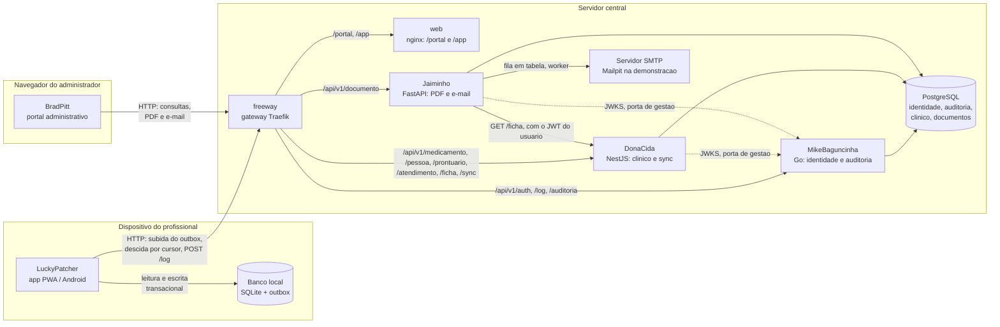
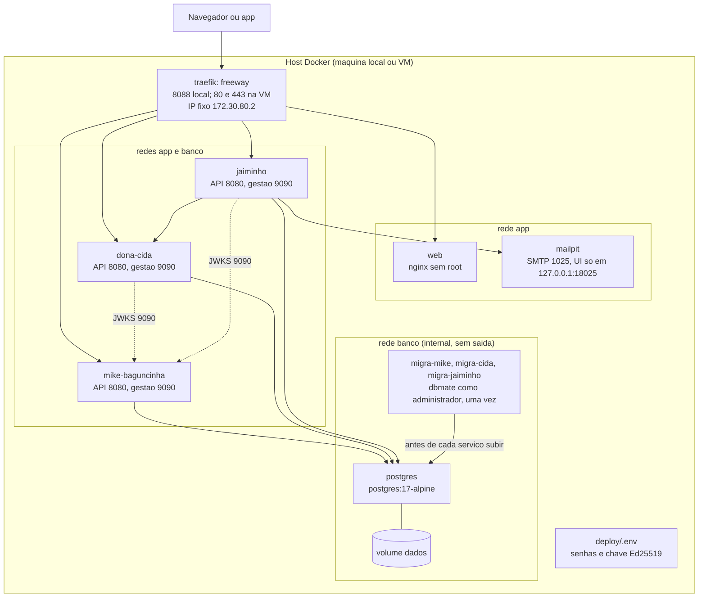

# Arquitetura do MedicalField

**Entregável 1 do enunciado — modelo de arquitetura: desenho + tecnologias utilizadas.**

Este documento descreve o sistema **como está implementado**. O plano que antecedeu a implementação está em [`plano-arquitetural.md`](plano-arquitetural.md); onde o código divergiu do plano, vale o que está aqui (seção 9). Detalhes: [sincronização](sincronizacao.md) · [segurança](seguranca.md) · [APIs](../api/README.md) · [dados](../dados/modelagem.md).

Todos os dados do sistema são **fictícios e sem validade clínica**.

## 1. Visão geral

O MedicalField é um prontuário de emergência pré-hospitalar **Offline-First**: o profissional registra o atendimento num banco local, com ou sem rede, e o app sincroniza com o servidor central quando a conexão existe.

| Peça | Codinome | Papel | Linguagem / base | Pasta |
| --- | --- | --- | --- | --- |
| Serviço de identidade e auditoria | **MikeBaguncinha** | Login, tokens, chave pública, log de acesso, logs do app | Go (`net/http` + `pgx`) | `apps/mike-baguncinha` |
| Núcleo clínico e sincronização | **DonaCida** | Pessoas, prontuários, atendimentos, idempotência, conflitos, cursor | TypeScript (NestJS) | `apps/dona-cida` |
| Serviço de documentos | **Jaiminho** | Ficha em PDF, fila e envio de e-mail | Python (FastAPI) | `apps/jaiminho` |
| Gateway | **freeway** | Roteamento por prefixo, limite de taxa no login, cabeçalhos | Traefik 3.5 (provedor de arquivo) | `deploy/gateway` |
| Portal administrativo | **BradPitt** | Consulta, PDF, e-mail, auditoria (somente leitura clínica) | React + Vite (SPA) | `apps/brad-pitt` |
| App do profissional | **LuckyPatcher** | Atendimento em campo, banco local, outbox, simulador de rede | React + Vite (PWA) + Capacitor | `apps/lucky-patcher` |
| Banco central | — | Um PostgreSQL, quatro schemas, um papel por serviço | PostgreSQL 17 | `apps/*/migrations` |
| Banco local | — | SQLite embarcado no app | SQLite WASM em OPFS (navegador) | `apps/lucky-patcher/src/banco` |

São **três serviços em três linguagens diferentes** (Go, TypeScript, Python), uma interface administrativa e uma aplicação cliente com interface gráfica, como o enunciado exige.

## 2. Diagrama geral

Como ler:

- **Uma só entrada.** Portal e app falam com o gateway, sempre em caminhos relativos `/api/v1/...`. O gateway roteia por prefixo **sem remover o prefixo** e **não autentica**: cada serviço valida o token sozinho (`deploy/gateway/rotas.yml`).
- **Um dono por dado.** Cada serviço escreve só no próprio schema, com o próprio papel de banco. A DonaCida não lê `identidade`; o Jaiminho não lê `clinico` — ele pede a ficha à DonaCida por HTTP.
- **A chave pública não passa pelo gateway.** A DonaCida e o Jaiminho buscam o JWKS na porta de gestão (9090) do MikeBaguncinha, que só é alcançável dentro das redes Docker do sistema.
- **O app não depende do servidor para funcionar.** Toda tela lê e grava no banco local; a rede só é usada pelo motor de sincronização.

## 3. Implantação com Docker Compose

Tudo roda em **Docker Compose** num único host: `deploy/compose.yaml` (modo local, `http://localhost:8088`) e, na VM da Univates, o mesmo arquivo somado a `deploy/compose.vm.yaml` (HTTPS com Let's Encrypt em `https://177-44-248-60.sslip.io`). Na VM, as imagens vêm do GHCR, publicadas pelo CI. A implantação na VM está **a validar** (ver seção 10).

> **Decisão revista.** O plano previa Kubernetes (k3s + Kustomize + Argo CD) — uma escolha própria, não uma exigência do enunciado. A VM entregue tem **1 vCPU e 1,6 GB de RAM**: o k3s pede no mínimo 2 GB e gasta cerca de 450–600 MB só com a orquestração, contra uns 70 MB do Docker. A implantação passou para Docker Compose, mantendo as mesmas imagens e o mesmo endurecimento dos contêineres. As evidências registradas antes da troca foram obtidas num k3s local.

| Recurso | Arquivo | Observação |
| --- | --- | --- |
| Composição | `deploy/compose.yaml` | Projeto `medicalfield`: Postgres, três migrações, três serviços, `web`, Mailpit e Traefik. |
| Override da VM | `deploy/compose.vm.yaml` | Porta 443, certificado Let's Encrypt (desafio HTTP-01, volume `acme`), HTTP só redireciona. |
| Rotas e middlewares do gateway | `deploy/gateway/rotas.yml` | Roteamento por prefixo; a rota exata de login tem o `limite-login` (10/min por IP); cabeçalhos de segurança, CORS do app. |
| Serviços | `deploy/compose.yaml` | Raiz somente leitura, sem root, `cap_drop: ALL`, `no-new-privileges`, limite de memória; sobem só depois da própria migração. |
| Migrações | `migra-*` em `deploy/compose.yaml`, imagem `deploy/migracoes/Dockerfile` | Serviços de execução única (`dbmate` + as migrações dos três serviços). |
| Postgres | `deploy/compose.yaml`, `deploy/db/` | Volume nomeado `dados`; papéis e schemas criados na primeira partida (`10-papeis-e-schemas.sh`). |
| Redes | `deploy/compose.yaml` | `banco` (interna: Postgres, migrações, serviços) e `app` (gateway, serviços, `web`, Mailpit). |
| Backup | `deploy/scripts/backup.sh`, `restore.sh` | `pg_dump` diário pelo cron do host; ver [`operacao/backup-e-recuperacao.md`](../operacao/backup-e-recuperacao.md). |
| Imagem `web` | `deploy/web/Dockerfile`, `deploy/web/nginx.conf` | Um nginx sem root serve os dois front-ends (`/portal/` e `/app/`). |
| Segredos | `deploy/scripts/segredos.sh` → `deploy/.env` | Fora do Git, `chmod 600`; gerados na máquina. |
| CI | `.github/workflows/ci.yml` | Testes dos três serviços e dos pacotes npm; valida os dois modos do Compose; em `main`, publica as 5 imagens no GHCR com as tags `<sha>` e `latest`. |

Consumo medido no k3s local, antes da troca (`kubectl top`, evidência E-007): cerca de 263 Mi de aplicação — Jaiminho 96 Mi, Mike 65 Mi, Cida 44 Mi, Postgres 29 Mi, Mailpit 16 Mi, web 13 Mi. No Compose, os limites de memória somam 1,7 GB no pior caso; o consumo real na VM está a medir (`docker stats`).

## 4. Tecnologias utilizadas

Versões **reais**: lidas de `go.mod`, `package-lock.json`, `pyproject.toml`, dos Dockerfiles, do `compose.yaml` e — onde o arquivo só fixa um mínimo — dos contêineres em execução no ambiente local.

### Backend

| Tecnologia | Versão | Onde | Por quê |
| --- | --- | --- | --- |
| Go | 1.27 | MikeBaguncinha (`go.mod`, `golang:1.27`) | Binário estático pequeno, partida imediata; roteamento por método já na biblioteca padrão, sem framework. |
| `pgx` | 5.13.0 | MikeBaguncinha | Driver Postgres com SQL explícito e pool. |
| `golang-jwt/jwt` | 5.3.1 | MikeBaguncinha | Emissão e validação do JWT EdDSA. |
| `golang.org/x/crypto` (Argon2id) | 0.59.0 | MikeBaguncinha | Hash de senha recomendado pela OWASP. |
| Node.js | 24 (24.22.3 em execução) | DonaCida (`node:24-alpine`) | Mesma linguagem do app: um só esquema de validação. |
| NestJS | 12.5.1 | DonaCida | Módulos, injeção de dependência, *guards* e filtros — a cadeia de middleware pedida pelo enunciado. |
| Express | 5.3.0 | DonaCida (plataforma do Nest) | Servidor HTTP por baixo do Nest. |
| Kysely | 0.29.9 (+ `pg` 8.23.1) | DonaCida | SQL tipado sem ORM: o `ON CONFLICT` e o cursor ficam à vista. |
| `jose` | 6.2.17 | DonaCida | Validação do JWT pela chave pública (JWKS com cache). |
| zod | 4.6.7 | `packages/contratos`, DonaCida, portal, app | O mesmo esquema valida o formulário, o outbox e a API. |
| esbuild | 0.28.2 | DonaCida (`apps/dona-cida/scripts/build.mjs`) | Empacota o serviço em um arquivo (`dist/main.mjs`). |
| Python | 3.13 (3.13.18 em execução) | Jaiminho (`python:3.13-slim`) | Ecossistema de PDF sem navegador. |
| FastAPI | 0.163.2 (mínimo declarado 0.115) | Jaiminho | Rotas tipadas e OpenAPI gerado. |
| Uvicorn | 0.54.0 | Jaiminho | Servidor ASGI. |
| psycopg | 3.3.9 | Jaiminho | Driver Postgres assíncrono, SQL explícito. |
| WeasyPrint | 70.0 (mínimo declarado 63) | Jaiminho | HTML + CSS vira PDF sem *headless browser*. |
| Jinja2 | 3.1.6 | Jaiminho | Template da ficha (`infra/pdf/ficha.html`). |
| segno | 1.6.6 | Jaiminho | QR de verificação do documento. |
| aiosmtplib | 5.1.3 | Jaiminho | Envio SMTP assíncrono. |
| PyJWT | 2.15.1 | Jaiminho | Validação do JWT EdDSA. |
| httpx | 0.28.1 | Jaiminho | Cliente HTTP para a DonaCida e o JWKS. |

### Dados

| Tecnologia | Versão | Onde | Por quê |
| --- | --- | --- | --- |
| PostgreSQL | 17 (17.12 em execução, `postgres:17-alpine`) | Banco central | Transações, papéis por schema, `jsonb`, gatilho para o cursor de sincronização, inserção manual por SQL (passo 9). |
| dbmate | 2 (`ghcr.io/amacneil/dbmate:2`) | Migrações dos três serviços | Uma ferramenta e uma convenção (SQL puro) para três linguagens. |
| SQLite WASM oficial | 3.54.1 (`@sqlite.org/sqlite-wasm`) | Banco local no navegador, em OPFS (`opfs-sahpool`) | SQLite de verdade gravando em arquivo: o `COMMIT` é durável. O `jeep-sqlite` foi descartado por perder dados em teste de queda ([durabilidade](../../apps/lucky-patcher/docs/durabilidade.md)). |
| `@capacitor-community/sqlite` | 8.1.1 | Banco local no Android (SQLCipher) | Adaptador nativo cifrado. Validado em emulador (E-008); não testado em aparelho físico. |

### Front-ends

| Tecnologia | Versão | Onde | Por quê |
| --- | --- | --- | --- |
| React | 19.3.1 | Portal e app | Uma base de componentes para os dois. |
| Vite | 8.3.8 | Portal e app | Build e servidor de desenvolvimento com proxy igual ao gateway. |
| TypeScript | 7.0.2 (5.9.3 em `packages/ui`) | Todo o código TS | Tipos compartilhados com o backend. |
| Tailwind CSS | 4.3.5 | `packages/ui`, portal, app | Tokens do design system. |
| React Router | 7.18.5 (portal) · 8.5.1 (app) | Navegação | No app, *hash router*: funciona no navegador, offline e no WebView. |
| TanStack Query | 5.108.0 | Portal | Cache e estados de carregamento das consultas. |
| `vite-plugin-pwa` (Workbox 7.4.1) | 2.0.0 | App | *Service worker* guarda a casca do app: abre sem rede. |
| Capacitor | 8.6.2 | App (Android) | Empacota o mesmo código web num APK. APK de depuração construído e validado em emulador (Pixel 6, Android 17). |
| lucide-react | 0.500.0 | Ícones | — |

### Infraestrutura e testes

| Tecnologia | Versão | Onde | Por quê |
| --- | --- | --- | --- |
| Docker Compose | v2 | `deploy/compose.yaml` (+ `compose.vm.yaml`) | Um arquivo, dois ambientes; cabe na VM de 1,6 GB (seção 3). |
| Traefik | v3.5 (`traefik:v3.5`) | Gateway "freeway" | Roteamento e middlewares por arquivo; Let's Encrypt embutido. |
| nginx (sem root) | 1.29 (`nginxinc/nginx-unprivileged:1.29-alpine`) | Imagem `web` | Servidor estático dos dois front-ends. |
| Mailpit | v1.27 | Servidor SMTP de captura | E-mail demonstrável sem credencial externa. |
| Vitest | 5.1.0 | Testes de TS | — |
| Playwright | 1.65.1 | E2E do portal, do app e o roteiro de 17 passos | Dirige o Chrome instalado. |
| pytest · Ruff | ≥ 8 · ≥ 0.8 | Jaiminho | Testes e lint. |
| Newman | 6.x (via `npx`) | Coleção Postman | Valida as rotas pela linha de comando. |

## 5. Responsabilidade e fronteira de cada serviço

### MikeBaguncinha (Go) — identidade e auditoria

- **Faz:** login por CRM, COREN ou ID de socorrista; emite o *access token* (JWT EdDSA) e o *refresh token* rotativo; publica a chave pública em JWKS; recebe os logs que o app gerou offline (`POST /log`); guarda e consulta o log de acesso de **todos** os serviços.
- **Dono de:** schemas `identidade` e `auditoria`.
- **Não faz:** nada clínico. Não conhece pessoa, prontuário nem atendimento.
- **Quem depende dele:** os outros dois serviços só precisam da chave pública (em cache); se o Mike cair, tokens já emitidos continuam válidos até expirar.

### DonaCida (NestJS) — núcleo clínico e sincronização

- **Faz:** cadastro de pessoas, prontuários e itens; atendimentos e a linha do tempo imutável de eventos; recepção idempotente dos comandos; resolução de conflitos; a descida por cursor; a ficha consolidada (`GET /ficha/{id}`).
- **Dona de:** schema `clinico`.
- **Não faz:** não autentica ninguém (só valida o token), não gera PDF, não envia e-mail, não lê `identidade` — o nome do profissional vem do token e é copiado no registro.
- **Não interpreta valor clínico:** as faixas numéricas são limites de digitação.

### Jaiminho (FastAPI) — documentos

- **Faz:** gera a ficha de atendimento em PDF, guarda o PDF com código de verificação e *hash*, e envia por e-mail com fila e retentativa.
- **Dono de:** schema `documentos`.
- **Não faz:** não lê o banco clínico. Busca a ficha na DonaCida por HTTP, **repassando o token do usuário** — o log de acesso da DonaCida registra o profissional real.

### freeway (Traefik) — gateway

- **Faz:** roteia por prefixo, aplica limite de taxa no login, acrescenta cabeçalhos de segurança, preserva o IP de origem.
- **Não faz:** não autentica, não reescreve caminho, não expõe a porta de gestão dos serviços (`/health/*` e `/jwks.json` respondem 404 pelo gateway — conferido).

## 6. Comunicação

| Fluxo | Estilo | Implementação |
| --- | --- | --- |
| Portal e app → gateway → serviço | HTTP síncrono, JSON | `deploy/gateway/rotas.yml` |
| Subida da sincronização | HTTP síncrono, **um comando por requisição**, a partir da fila persistente no dispositivo | `apps/lucky-patcher/src/sync/motor.ts` (`subir`) |
| Descida da sincronização | HTTP síncrono, *pull* por cursor | `motor.ts` (`descer`) → `GET /sync/alteracoes` |
| Jaiminho → DonaCida | HTTP síncrono, com o JWT do usuário | `apps/jaiminho/src/jaiminho/infra/clinico.py` |
| Validação de token | Chave pública em cache (5 min), sem chamada por requisição | `apps/dona-cida/src/infra/verificador-token.ts`, `apps/jaiminho/src/jaiminho/infra/jwks.py` |
| Log de acesso | Inserção assíncrona em lote (1 s ou 100 linhas) | `infra/gravador_acesso.go`, `infra/log-acesso.ts`, `infra/log.py` |
| Envio de e-mail | **Assíncrono**, fila em tabela | `documentos.envio_email` + `aplicacao/envios.py` (`WorkerEnvios`) |
| Geração de PDF | Síncrono (cerca de 1 s) | `aplicacao/documentos.py` |

### A fila em tabela, e por que não RabbitMQ

O único fluxo realmente assíncrono do sistema é o envio de e-mail. Ele usa a tabela `documentos.envio_email` como fila:

- `POST /documento/{id}/email` apenas grava uma linha `PENDENTE` e responde **202** — uma falha de SMTP nunca falha a requisição.
- Um *worker* no próprio processo do Jaiminho consulta a cada 5 s (e é acordado na hora quando entra um envio) e reserva a próxima linha com `UPDATE ... WHERE id = (SELECT ... FOR UPDATE SKIP LOCKED)` (`infra/banco.py`, `reservar_proximo`).
- Falhou: nova tentativa em 1, 5, 15 e 60 min; na 5ª tentativa vira `FALHA_DEFINITIVA` (`dominio/regras.py`, `proxima_situacao`). `ENVIANDO` há mais de 5 min volta a `PENDENTE`.
- Entrega **ao menos uma vez**, com `Message-ID` fixo por envio.

Um broker foi avaliado e rejeitado: há um produtor e um consumidor, dentro do mesmo serviço, com volume de unidades por dia. O RabbitMQ custaria mais um contêiner com estado, credenciais, filas mortas e cerca de 150 MB de memória, sem entregar nada que a tabela não entregue — ela já é durável, transacional com o pedido, visível por SQL e guarda cada tentativa. Faria sentido se um mesmo fato precisasse de vários consumidores independentes.

Na sincronização, a durabilidade está **no dispositivo** (o outbox): o trecho não confiável é o rádio do celular, não a rede interna do servidor, então um broker no servidor não ajudaria.

## 7. Padrões de projeto

Os três sugeridos pelo enunciado e três de livre escolha, com o arquivo onde cada um está.

| # | Padrão | Problema que resolve | Onde está |
| --- | --- | --- | --- |
| 1 | **Repository** (enunciado) | A tela não pode saber se o dado vem do SQLite ou da API | **App, dado local:** `apps/lucky-patcher/src/dados/pessoas.ts` (`RepositorioPessoas`, `RepositorioProntuarios`, `RepositorioMedicamentos`), `dados/atendimentos.ts` (`RepositorioAtendimentos`), `dados/pendencias.ts`. **App, dado remoto:** `sync/http.ts` (`ClienteHttp`, o único que chama `fetch`), usado só por `sync/sessao.ts` e `sync/motor.ts` — nenhuma tela fala com a API. **Serviços:** interface em `apps/dona-cida/src/dominio/repositorios.ts` e SQL em `infra/repositorio-clinico.ts`; `internal/dominio/identidade.go` e `internal/infra/postgres.go` no Go; `dominio/portas.py` e `infra/banco.py` no Python. |
| 2 | **Strategy** (enunciado) | Cada tipo de dado pede uma regra de conflito diferente | `apps/dona-cida/src/dominio/conflito/`: interface em `estrategia.ts`; `uniao-imutavel.ts`, `campo-mais-recente.ts`, `servidor-vence.ts`, `revisao-manual.ts`; `registro.ts` escolhe a estratégia pelo tipo de dado. |
| 3 | **Observer** (enunciado) | Sincronizar quando a rede volta, sem a tela consultar a rede | `apps/lucky-patcher/src/sync/conectividade.ts` (`MonitorConectividade`: `assinar` / `publicar`). Assinantes: `sync/motor.ts` (`iniciar` dispara `sincronizar('conexao')` quando o estado passa a online) e a interface (`ui/contexto.tsx`, `useConectividade`). |
| 4 | **Command** (livre) | Uma ação precisa ser guardada, reenviada e repetida com segurança | **App:** `dados/outbox.ts` — cada operação vira uma linha serializável (método, rota, corpo, `op_id`) na tabela `outbox`. **Servidor:** `apps/dona-cida/src/aplicacao/comando.ts` (`ExecutorComandos`, o receptor idempotente). |
| 5 | **Adapter** (livre) | A mesma lógica sobre mecanismos diferentes | **Banco local:** porta `apps/lucky-patcher/src/banco/executor.ts` (`ExecutorSql`) com `executorWeb.ts` (SQLite WASM/OPFS), `executorCapacitor.ts` (Android) e `executorOo1.ts` (memória, nos testes). **E-mail:** `EnviadorEmail` em `apps/jaiminho/src/jaiminho/dominio/portas.py`, com `EnviadorEmailSmtp` e `EnviadorEmailFalso` em `infra/email.py`. |
| 6 | **Chain of Responsibility** (livre) | Preocupações transversais sem poluir o handler — é o "middleware/interceptor" do enunciado | `request-id → log de acesso → autenticação → handler`, nos três: `apps/mike-baguncinha/internal/http/servidor.go` (`Handler`); `apps/dona-cida/src/http/cadeia.ts` + `app.module.ts` (`configure`); `apps/jaiminho/src/jaiminho/http/middlewares.py` + `http/app.py`. |

Além desses, três padrões **arquiteturais**: *Transactional Outbox* (app e fila de e-mail), *Idempotent Receiver* (DonaCida) e *API Gateway* (freeway).

## 8. Camadas

Os três serviços usam as mesmas quatro camadas, com os mesmos nomes. A dependência aponta para dentro: `http` → `aplicacao` → `dominio` ← `infra`.

| Camada | Contém | Go (MikeBaguncinha) | TypeScript (DonaCida) | Python (Jaiminho) |
| --- | --- | --- | --- | --- |
| `http` | Rotas, DTOs, middlewares, tradução de erro | `internal/http/servidor.go`, `handlers.go`, `ip.go` | `src/http/controllers.ts`, `cadeia.ts`, `filtro-erros.ts` | `src/jaiminho/http/rotas.py`, `middlewares.py`, `erros.py` |
| `aplicacao` | Casos de uso | `internal/aplicacao/autenticacao.go`, `auditoria.go`, `limitador.go` | `src/aplicacao/atendimento.ts`, `pessoa.ts`, `prontuario.ts`, `comando.ts`, `consultas.ts` | `src/jaiminho/aplicacao/documentos.py`, `envios.py` |
| `dominio` | Entidades, regras puras, interfaces | `internal/dominio/identidade.go`, `auditoria.go` | `src/dominio/conflito/`, `relogio.ts`, `hash.ts`, `repositorios.ts` | `src/jaiminho/dominio/modelos.py`, `regras.py`, `portas.py` |
| `infra` | SQL, HTTP de saída, SMTP, configuração | `internal/infra/postgres.go`, `token.go`, `senha.go`, `gravador_acesso.go`, `config.go` | `src/infra/repositorio-clinico.ts`, `verificador-token.ts`, `log-acesso.ts`, `config.ts` | `src/jaiminho/infra/banco.py`, `clinico.py`, `email.py`, `jwks.py`, `pdf/renderizador.py` |
| Montagem | Injeção manual das dependências | `cmd/mike-baguncinha/main.go` | `src/app.module.ts` | `src/jaiminho/montagem.py` |

O domínio está em português (`Pessoa`, `Atendimento`, `Prontuario`); os termos técnicos, em inglês (`Repository`, `UseCase`).

Código compartilhado entre o backend TypeScript e os dois front-ends (monorepo npm *workspaces*):

| Pacote | Conteúdo |
| --- | --- |
| `packages/contratos` | Esquemas zod e tipos de todas as rotas (o `openapi.yaml` da DonaCida é gerado a partir dele). |
| `packages/dominio` | Funções puras: total do Glasgow, ordenação da linha do tempo, resumo da passagem de caso. |
| `packages/ui` | Design system: tokens, tipografia e componentes React ([`DESIGN.md`](../../DESIGN.md)). |

## 9. O que mudou em relação ao plano

| Tema | Plano | Implementado | Motivo |
| --- | --- | --- | --- |
| Banco local no navegador | `jeep-sqlite` (sql.js + IndexedDB) | **SQLite WASM oficial em OPFS** (`opfs-sahpool`) | No teste de queda, o `jeep-sqlite` perdeu 5 de 5 gravações; o SQLite WASM manteve 5 de 5 (`apps/lucky-patcher/docs/durabilidade.md`). Só o adaptador web mudou. |
| Referência do atendimento | `prontuarioId` enviado pelo cliente | **`pessoaId`**; o servidor resolve (ou cria) o prontuário | Dois aparelhos podem criar prontuário para a mesma pessoa offline; com o id do cliente o atendimento seria rejeitado por chave estrangeira. |
| Migrações | Papel do serviço | **Administrador**, por uma imagem única de migrações, num contêiner de execução única antes do serviço; o serviço usa papel restrito | Se o papel do serviço fosse dono das tabelas, o "somente inserção" da linha do tempo e da auditoria não valeria. |
| Nome do profissional | — | `profissional_nome` copiado no atendimento e no evento | A DonaCida não lê o schema `identidade`. |
| Acesso a dados no Go | `sqlc` + `pgx` | Só `pgx`, SQL escrito à mão | Poucas consultas; gerador não se pagava. |
| Formulários | React Hook Form + zod | Estado do React + zod | Sem dependência extra; a validação é a do contrato. |
| Sessão do app | *Refresh token* no Keystore (Android) / cookie (web) | Sessão inteira no **banco local** (cifrado só no Android); o cookie `HttpOnly` é usado apenas pelo portal | O app precisa abrir sem rede; ver [segurança](seguranca.md). |
| App Android | APK entregue | **APK de depuração**, validado em **emulador**; não assinado para publicação, sem teste em aparelho físico | O Gradle exigiu uma pasta temporária de caminho curto (D-09); ver `apps/lucky-patcher/docs/nativo.md`. |
| Implantação | Kubernetes (k3s) na VM, Kustomize, Argo CD | **Docker Compose**, imagens do GHCR, atualização por `docker compose pull && up -d` | A VM tem 1 vCPU e 1,6 GB de RAM; o k3s pede ao menos 2 GB (seção 3). |

## 10. Estado atual

| Item | Situação |
| --- | --- |
| Três serviços, gateway, portal e app integrados | Validado no Docker Compose local (roteiro de 17 passos) |
| Roteiro acadêmico de 17 passos | Validado, automatizado (`e2e/roteiro.spec.ts`) |
| Offline-First (outbox, reabertura, queda no meio, resposta perdida) | Validado no navegador |
| Coleção Postman de todas as rotas | Validada com Newman contra o gateway |
| Conflito com dois clientes reais | Só testes de integração do servidor |
| Isolamento de rede e backup/restauração | Backup/restauração executados no Compose local; isolamento pelas redes Docker a validar |
| App Android | APK de depuração construído e validado em emulador (`e2e/android/android.mjs`, E-008): login, offline, processo morto e reaberto, sincronização sem duplicar, banco cifrado. **Não testado em aparelho físico**; APK não assinado; HTTP sem TLS até o gateway local |
| VM da Univates e acesso público HTTPS | **A validar** — documentado em [`operacao/instalacao-vm.md`](../operacao/instalacao-vm.md) |
| E-mail em caixa externa | Não testado — validado contra o Mailpit (SMTP real de captura) |

Fonte: [`VALIDATION_MATRIX.md`](../VALIDATION_MATRIX.md), [`VALIDATION_EVIDENCE.md`](../VALIDATION_EVIDENCE.md), [`KNOWN_ISSUES.md`](../KNOWN_ISSUES.md).
