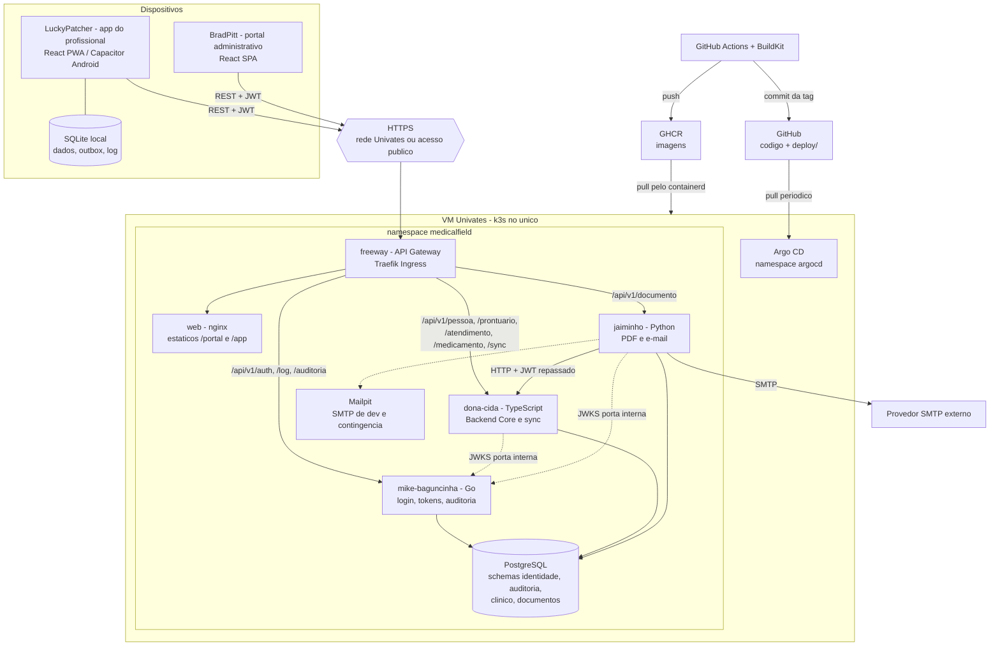
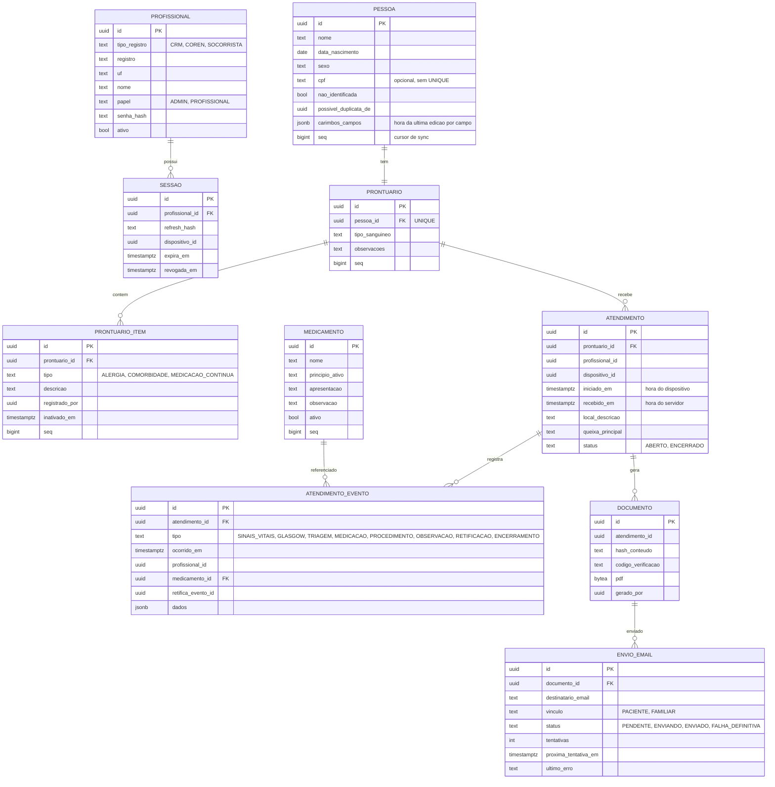
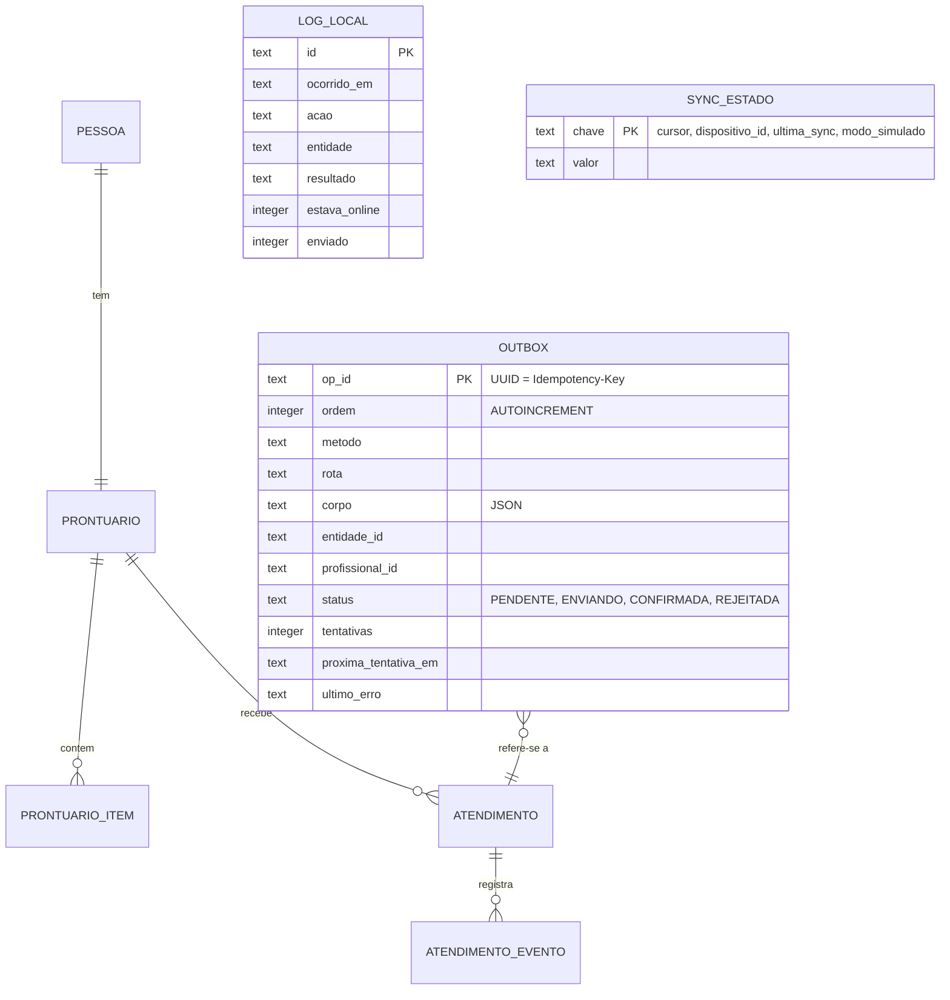
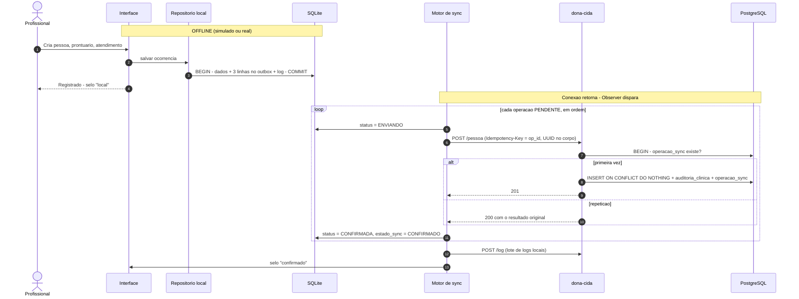
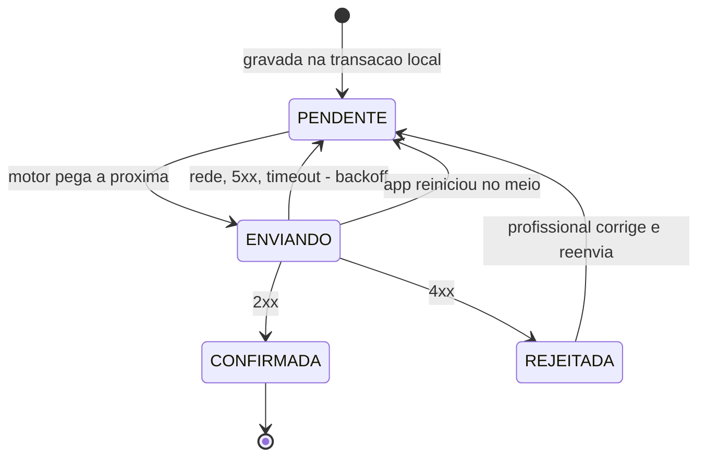
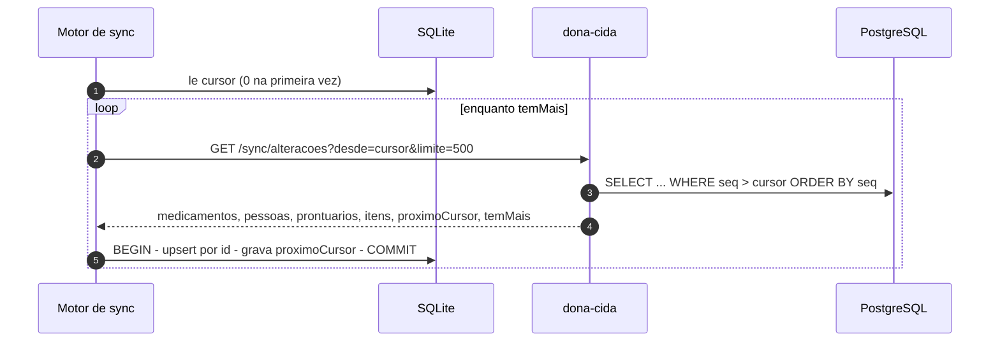
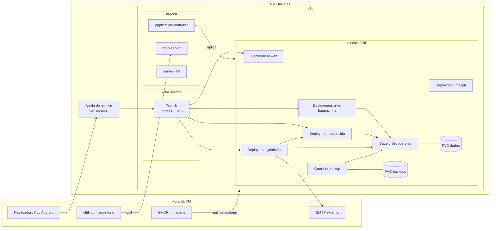

# MedicalField — Análise arquitetural e roteiro de implementação

> Fase de planejamento. Nada foi criado, instalado ou alterado. Único arquivo escrito: este plano.

> **Decisão revista (implantação):** o Kubernetes (k3s + Kustomize + Argo CD) deste plano foi substituído por **Docker Compose**. A VM da Univates tem 1 vCPU e 1,6 GB de RAM; o k3s pede ao menos 2 GB e gasta 450–600 MB só com a orquestração (o Docker, cerca de 70 MB). Kubernetes era requisito próprio, não do enunciado. Como está implementado: [`arquitetura.md`](arquitetura.md), seção 3.

## Contexto

**O que é:** trabalho final de Arquiteturas de Software (Univates, 2026/B, Prof. Fabrício) — prontuário médico de emergência *Offline-First* para equipes pré-hospitalares, com ≥3 serviços backend em linguagens distintas, portal administrativo, cliente com banco local e simulador de rede, PDF da ficha e envio por e-mail.

**Fontes analisadas**

| Fonte | Situação |
| --- | --- |
| `final_project_as_2026b.pdf` | **Lido integralmente**: 4 páginas, texto e imagem de cada página (tabela de endpoints, checklist, roteiro de 17 passos, requisitos técnicos). |
| Workspace `C:\STW\mes3-unified` | Inspecionado em modo leitura. É o monorepo MES3 (projeto de trabalho, sem relação). Busca por `medicalfield` sem resultado; nenhuma pasta irmã em `C:\STW` é do projeto. **Não existe código, configuração nem documentação do MedicalField.** |
| Pesquisa externa (nov/2026) | k3s, Argo CD, túneis, SQLite no navegador, e-mail gratuito. Fontes no fim; o que não foi confirmado em fonte oficial está marcado **[não verificado]**. |

**Decisão de workspace:** o MedicalField nasce em **repositório novo e próprio** (ex.: `C:\dev\medicalfield`, GitHub pessoal), nunca dentro do `mes3-unified`. Nada do MES3 é reaproveitado — nem código, nem a stack por hábito.

**Divergências entre o PDF e o pedido** (nada foi reinterpretado em silêncio)

| # | PDF | Pedido adicional | Tratamento |
| --- | --- | --- | --- |
| 1 | "Não é necessário utilizar contêineres." | Kubernetes obrigatório | K8s é requisito **seu**, não acadêmico. É compatível (a VM continua sendo o ambiente), mas adiciona risco de infraestrutura — ver K e R. |
| 2 | §2.1: ≥3 linguagens; "Requisitos técnicos": "mais de uma linguagem" | 3 linguagens | Adotado o mais restritivo: **3**. |
| 3 | Checklist com **3** entregáveis (arquitetura; docs de API + modelagem; roteiro de testes) | 4 entregáveis | Mesmo conteúdo; a modelagem de BD fica junto da doc de API, como no PDF. |
| 4 | `GET /prontuario/{id}` e `GET /atendimento/{id}`: `{id}` é o **id da pessoa** | "retrieve a specific medical record" | Mantida a semântica do PDF; rotas extras cobrem o resto (seção O). Confirmar com o professor. |
| 5 | Uma GUI administrativa + uma GUI cliente | Web **e** mobile | Adicional; resolvido com um único código do cliente (seção I). |
| 6 | Sem data de entrega | — | **Prazo desconhecido.** O roteiro tem linha de corte explícita (seção Q). |

---

## A. Entendimento do trabalho

**Problema.** Socorristas atendem onde a rede é instável ou inexistente. Sinais vitais, Glasgow, triagem (Manchester/START) e medicamentos precisam ser registrados na hora, e chegar íntegros ao hospital. Depender da nuvem para gravar é inaceitável.

**Usuários.** (1) Profissional em campo — médico (CRM), enfermagem (COREN), socorrista (ID) — usa o **cliente**. (2) Equipe administrativa/reguladora — usa o **portal** central. (3) Paciente ou familiar — recebe a ficha em PDF por e-mail.

**Casos de uso principais.** Autenticar; baixar cadastros de apoio; registrar ocorrência (pessoa → prontuário → atendimento com linha do tempo) com ou sem rede; sincronizar; consultar no portal; gerar PDF; enviar e-mail.

**Classificação dos requisitos**

| Classe | Itens |
| --- | --- |
| 1. Obrigatório acadêmico | ≥3 serviços em linguagens distintas; banco central + banco local embarcado; execução na VM Univates; autenticação em todas as rotas exceto login; middleware de log de acesso com 7 campos em todos os serviços; cliente com GUI e seletor Online/Offline; portal com GUI (autenticar, ver atendimentos e cadastros de apoio); idempotência, rastreabilidade e tratamento de conflitos; PDF para download; e-mail com anexo; rotas validáveis no Postman; roteiro de 17 passos; 3 entregáveis. |
| 2. Sugestão do professor | Os 9 endpoints; Repository, Strategy, Observer (+3 livres); exemplo de merge por carimbo de data/hora mais recente; Outbox. |
| 3. Livre escolha | Banco, linguagens, frameworks, formato do token, uso ou não de contêineres. |
| 4. Adicional deste pedido | Web + mobile; Kubernetes; **Argo CD**; acesso público sem custo; diferencial de produto; separação gateway/core/microsserviços; padronização de código. |
| 5. A investigar antes de fixar | Especificações e restrições da VM; política de rede da Univates; prazo; semântica do `{id}`. |

**Matriz de rastreabilidade**

| ID | Requisito | Origem | Como é atendido | Responsável | Validação |
| --- | --- | --- | --- | --- | --- |
| RA01 | ≥3 serviços/APIs autônomos em linguagens distintas | PDF 2.1 | Go, TypeScript e Python, cada um com processo, imagem, schema e OpenAPI próprios | `mike-baguncinha`, `dona-cida`, `jaiminho` | 3 Deployments; 3 specs |
| RA02 | Banco central | PDF 2.1 | PostgreSQL, um schema por serviço | StatefulSet `postgres` | ER + migrações |
| RA03 | Banco local embarcado | PDF 2.1 | SQLite no cliente (nativo no Android, WASM no navegador) | `apps/lucky-patcher` | T-09, passo 12 |
| RA04 | Execução na VM Univates | PDF 2.1 | k3s de nó único na VM | `deploy/` | Fase 1 |
| RA05 | Rotas autenticadas (exceto login), credencial profissional | PDF 2.1 | JWT emitido no login por CRM/COREN/ID; **cada serviço** valida | os 3 serviços | T-01..T-04 |
| RA06 | Middleware de log de acesso (7 campos) | PDF 2.1 | Middleware equivalente nos 3 serviços → stdout JSON + `auditoria.log_acesso` | os 3 serviços | T-16 |
| RA07 | Cliente com ficha + "Simular Conectividade" | PDF 2.1 | Seletor persistente que corta toda chamada remota | `apps/lucky-patcher` | passos 7, 12, 14 |
| RA08 | Portal: autenticar, ver atendimentos e cadastros | PDF 2.1 | SPA web somente leitura + PDF/e-mail | `apps/brad-pitt` | passos 1–4 |
| RA09 | Idempotência, rastreabilidade, conflitos | PDF 1 | UUID gerado no cliente + `Idempotency-Key` + `operacao_sync`; estratégias por tipo de dado | `dona-cida`, cliente | T-05..T-12 |
| RA10 | PDF da ficha para download | PDF 1, 2.3 | HTML→PDF no serviço de documentos | `jaiminho` | passo 16 |
| RA11 | E-mail com o PDF anexado | PDF 1, 2.3 | Fila persistente + SMTP, com retentativa | `jaiminho` | passo 17, T-18/19 |
| RA12 | Repository, Strategy, Observer + 3 | PDF 2.2 | Seção N | cliente e serviços | revisão de código |
| RA13 | 9 endpoints + rotas de PDF e e-mail | PDF 2.3 | Seção O (caminhos do PDF preservados) | os 3 serviços | coleção Postman |
| RA14 | Validável via Postman/Insomnia | PDF req. técnicos | Coleção versionada no repositório | `docs/api` | Newman no CI |
| RA15 | Entregáveis | PDF checklist | `docs/` escrito a cada fase | `docs/` | checklist final |
| RA16 | Roteiro de 17 passos | PDF p.4 | Seção P; automatizado em Playwright | todos | E2E verde |
| RX01 | Web e mobile | Pedido | Um código React: PWA no navegador + Capacitor no Android | `apps/lucky-patcher` | APK + PWA |
| RX02 | Kubernetes + Argo CD | Pedido | k3s + Kustomize + Argo CD (GitOps por *pull*) | `deploy/` | T-20/21 |
| RX03 | Acesso público sem custo | Pedido | Árvore de decisão da seção L | `deploy/` | URL HTTPS |
| RX04 | Diferencial de produto | Pedido | Linha do tempo imutável + passagem de caso verificável | cliente, clínico, documentos | demo |
| RX05 | Código padronizado | Pedido | Mesmas 4 camadas e mesmos nomes nos 3 serviços | seção M | revisão |

**Restrições e premissas** (detalhe em R): VM de especificação desconhecida; desenvolvimento em Windows (sem build iOS); dados **fictícios** em toda demonstração; conteúdo clínico apenas registrado, nunca decidido pelo sistema.

---

## B. Conceito de produto e diferencial

**Direções avaliadas**

| Ideia | Problema que resolve | Offline? | Impacto arquitetural | Complexidade | Demonstrável | Veredito |
| --- | --- | --- | --- | --- | --- | --- |
| **Linha do tempo imutável do atendimento** (cada sinal vital, medicação, procedimento é um evento com hora e autor) | Ordem e horário reais do que foi feito; base da continuidade do cuidado | Sim | Modelo *append-only* — elimina a maior parte dos conflitos de sync | Baixa | Alta | **Escolhida** |
| **Passagem de caso** (resumo factual gerado da linha do tempo, para a entrega no hospital) | Perda de informação na troca de equipe | Sim | Função pura sobre os eventos | Baixa | Alta | **Escolhida** |
| **Ficha verificável** (código de integridade + QR no PDF) | Confiança no documento que sai do sistema | Geração online | Hash do conteúdo no serviço de documentos | Baixa | Alta | **Escolhida** |
| Transparência de sincronização (selo local / enviado / confirmado em cada registro) | Dúvida "isso já subiu?" | Sim | Já existe no outbox | Muito baixa | Alta | **Escolhida** (vem de graça) |
| Painel de múltiplas vítimas (START em desastre) | Triagem em massa | Sim | Nova agregação ocorrência→N pacientes | Média | Alta | Fora do escopo; extensão natural |
| Pré-aviso em tempo real ao hospital | Preparo da emergência | Não | Novo app receptor + push | Alta | Média | Rejeitada: depende de rede e dobra o escopo |
| Sync dispositivo a dispositivo (Bluetooth/Wi-Fi Direct) | Dois socorristas, zero rede | Sim | P2P nativo, CRDT | Muito alta | Baixa | Rejeitada |
| Ditado por voz | Mãos ocupadas | Parcial | Motor de voz local | Alta | Instável | Rejeitada |
| Alertas automáticos de dose/contraindicação | Erro de medicação | Sim | Base clínica validada | — | — | **Vetada**: decisão clínica sem validação |

**Direção escolhida — "a caixa-preta do atendimento pré-hospitalar".** O atendimento não é um formulário preenchido no fim: é uma **linha do tempo imutável** de eventos carimbados com hora, profissional e dispositivo. Dela saem, sem lógica nova: a **passagem de caso** (últimos sinais vitais, Glasgow mais recente, classificação de triagem, medicações com dose e horário, alergias conhecidas) e a **ficha em PDF verificável**.

Por que é a escolha certa e não um enfeite: a mesma decisão de modelo que dá identidade ao produto **simplifica a arquitetura** — eventos imutáveis com UUID sincronizam por união, são idempotentes por construção e já são a trilha de auditoria. Diferencial e requisito acadêmico saem do mesmo desenho.

**Segurança de medicação sem decisão clínica.** O PDF cita erro de medicação. O sistema responde só com **exibição factual**: ao registrar um medicamento, a tela mostra o que já foi administrado neste atendimento (o quê, dose, há quanto tempo) e as alergias registradas do paciente. Nenhuma regra de dose, interação ou contraindicação é codificada.

---

## C. Arquitetura completa



**Nomes dos serviços** (escolhidos por você)

| Nome | Identificador técnico | Em uma frase |
| --- | --- | --- |
| **MikeBaguncinha** | `mike-baguncinha` (Go) | O porteiro: confere a credencial no login, entrega o crachá (token) e anota quem acessou o quê, quando e de qual IP. |
| **DonaCida** | `dona-cida` (TypeScript) | O coração clínico: guarda pessoas, prontuários, atendimentos e medicamentos; recebe o que os celulares mandam quando a rede volta, sem duplicar, e devolve as novidades. |
| **Jaiminho** | `jaiminho` (Python) | O carteiro: monta a ficha em PDF, guarda uma cópia e entrega por e-mail, tentando de novo se falhar. |
| **freeway** | `freeway` (Ingress do Traefik) | O gateway: porta de entrada única, encaminha cada requisição ao serviço certo. Não é código nosso e não conta entre os três serviços. |
| **BradPitt** | `apps/brad-pitt` (React SPA) | O portal administrativo: lista cadastros, prontuários, atendimentos e logs; gera o PDF e manda o e-mail. |
| **LuckyPatcher** | `apps/lucky-patcher` (React PWA + Capacitor) | O app do profissional, no navegador e no Android: registra a ocorrência com banco local e seletor Online/Offline. |

São **codinomes internos** (repositório, diagrama, manifestos). Na tela, o usuário vê "MedicalField". O roteiro de testes mantém os termos do PDF — "Portal" = BradPitt, "Cliente" = LuckyPatcher. O identificador do pacote Android fica neutro (`br.medicalfield.cliente`): "Lucky Patcher" é o nome de um aplicativo real de modificação de APKs, e um pacote com esse nome pode confundir antivírus e quem for instalar.

O identificador técnico é minúsculo com hífen porque nomes de recursos do Kubernetes, imagens e pastas não aceitam maiúsculas. Os schemas do banco continuam descritivos (`identidade`, `auditoria`, `clinico`, `documentos`) — quem abre o banco no passo 9 precisa entender o que está vendo.

**O que é implantável e o que é módulo**

| Componente | Tipo | Responsabilidade | Dono dos dados |
| --- | --- | --- | --- |
| **freeway** (gateway) | Infra pronta (Traefik do k3s) — **não é código nosso e não conta** como serviço | TLS, roteamento por caminho, CORS, limite de taxa, cabeçalhos de encaminhamento, `X-Request-Id` | — |
| `web` | Deployment (nginx) | Serve os estáticos do portal e do cliente web | — |
| `mike-baguncinha` (Go) | **Serviço 1** | Quem é você e o que você acessou: login, tokens, chaves, logs de acesso, logs do cliente offline | `identidade`, `auditoria` |
| `dona-cida` (TypeScript) | **Serviço 2 — Backend Core** | Domínio clínico e recepção da sincronização: pessoa, prontuário, atendimento, eventos, medicamentos | `clinico` |
| `jaiminho` (Python) | **Serviço 3** | Ficha em PDF, fila e envio de e-mail | `documentos` |
| Sincronização | Módulo do `dona-cida` + módulo do cliente | Recebe comandos idempotentes; entrega alterações por cursor | — |
| Auditoria clínica | Módulo do `dona-cida` | Trilha de quem criou/alterou dado clínico, na mesma transação | `clinico.auditoria_clinica` |
| `postgres` | StatefulSet | Persistência central | — |
| Argo CD | Infra | Entrega contínua por GitOps | — |

**Por que estes três limites e não outros**

- **Identidade + auditoria de acesso** são o mesmo assunto (controle de acesso e sua evidência), mudam por motivos de conformidade e precisam continuar de pé quando o domínio clínico está fora. Separar auditoria em um quarto serviço só adicionaria um salto de rede em toda requisição.
- **Clínico + sincronização** ficam juntos de propósito: sincronizar *é* o caminho de escrita do domínio clínico. Separar criaria uma transação distribuída no ponto mais sensível do sistema.
- **Documentos** tem perfil diferente de tudo: CPU em rajada, integração externa lenta e falível (SMTP), fila própria. Se cair, registrar atendimento continua funcionando.
- **Não viraram serviço:** gateway (infra), sincronização, auditoria clínica, notificações. Cada um seria um serviço sem dado próprio.

**Dependências em tempo de execução.** `jaiminho → dona-cida` (uma chamada, ao gerar a ficha). Todos → JWKS do `mike-baguncinha` (em cache, só na renovação de chave). Nenhuma dependência circular; `dona-cida` não chama ninguém.

---

## D. Decisões de tecnologia

| Decisão | Requisito | Alternativas avaliadas | Escolha | Por quê |
| --- | --- | --- | --- | --- |
| Linguagem do core clínico | Validação rica, transações, contrato compartilhado com o cliente | Kotlin/Java (Spring), C# (.NET), Go, Python, Rust, TypeScript | **TypeScript + NestJS** | Único que permite **um só esquema de validação** (zod) usado no formulário do cliente, no outbox e na API — o contrato de sync não pode divergir. JVM custaria 300–500 MB num nó pequeno. NestJS traz módulos, DI, *guards* e *interceptors* (o PDF pede literalmente "middleware/interceptor"). |
| Linguagem de identidade/auditoria | Criptografia sólida, ingestão de log barata, sempre no ar | Rust, Java, C#, Go | **Go** (biblioteca padrão `net/http` + `pgx`) | Binário estático de ~15–30 MB de RAM, partida instantânea, roteamento por método já na stdlib (sem framework). Rust daria o mesmo com custo de desenvolvimento maior. |
| Linguagem de documentos | HTML→PDF sem navegador, SMTP | Node+Puppeteer (Chromium, >300 MB), Java+iText/Jasper, C#+QuestPDF, Go+maroto, Python+ReportLab | **Python + FastAPI + WeasyPrint** | Template HTML/CSS (Jinja2) vira PDF sem *headless browser*; SMTP na stdlib; OpenAPI automático. ReportLab exigiria desenhar o layout em código. |
| Banco central | Integridade relacional, inserção manual por SQL (passo 9), cursor de alterações | MongoDB, MySQL/MariaDB, SQLite central, Postgres gerenciado gratuito (Neon/Supabase) | **PostgreSQL** | Transações, `gen_random_uuid()`, *triggers* para o cursor de sync, JSONB para o conteúdo dos eventos, papéis por schema. Gerenciado externo tiraria o dado da VM. |
| Topologia de persistência | Dono claro dos dados sem custo operacional | Um banco por serviço (3 instâncias); schema único compartilhado | **Uma instância, um schema por serviço, um papel de banco por serviço** | Isolamento real (papel sem `GRANT` não lê schema alheio) com um único StatefulSet, um backup, ~250 MB. Três instâncias triplicariam RAM e operação sem ganho neste porte. |
| Banco local | Embarcado, transacional, igual em web e mobile | IndexedDB/Dexie, RxDB (storage SQLite é pago), WatermelonDB (web usa LokiJS, não SQLite), PowerSync, ElectricSQL | **SQLite** via `@capacitor-community/sqlite` (SQLCipher no Android; `jeep-sqlite` no navegador) | Uma API nas duas plataformas, transação real (dado + outbox no mesmo commit), criptografia no dispositivo. Frameworks de sync foram rejeitados: esconderiam exatamente o que o trabalho avalia (Outbox, Observer, Strategy). |
| Cliente web + mobile | Um código, mesmo comportamento offline | React Native/Expo, Flutter, nativo (Kotlin/Swift), PWA pura, Tauri | **React + Vite + PWA, empacotado com Capacitor (Android)** | Expo: SQLite na web ainda **alpha** e exige COOP/COEP. Flutter: outra linguagem, sem contrato compartilhado, portal em outra stack. PWA pura não é app mobile. Capacitor entrega APK real com o mesmo código que roda no projetor. |
| Portal | Somente leitura, online | Mesmo app com rotas por papel; SSR (Next.js) | **React + Vite SPA separado** | O PDF distingue as duas aplicações; o portal não carrega banco local nem outbox. Compartilha `packages/` com o cliente. |
| Comunicação | Simplicidade com confiabilidade | RabbitMQ, NATS, Kafka, gRPC | **HTTP/REST + fila em tabela Postgres** | Só existe um fluxo assíncrono (e-mail), com um produtor e um consumidor no mesmo serviço. Seção G. |
| Token | Validação local em 3 linguagens | Sessão opaca + introspecção; HS256 com segredo compartilhado | **JWT assinado com EdDSA (Ed25519) + JWKS** | Só a identidade tem a chave privada; os outros validam offline com a pública. Segredo compartilhado deixaria qualquer serviço emitir token. |
| Migrações | Mesma convenção nos 3 serviços; *triggers* e *grants* | Drizzle Kit, Alembic, goose, Flyway | **SQL puro + `dbmate`** em `initContainer` | Uma ferramenta, uma convenção, três linguagens. *Triggers*, papéis e *grants* são SQL de qualquer forma. |
| Acesso a dados | SQL explícito e tipado | ORMs completos (Prisma, SQLAlchemy, GORM) | **Kysely** (TS), **sqlc + pgx** (Go), **psycopg 3** (Python) | Upsert idempotente e consulta por cursor pedem SQL à vista; ORM esconderia o `ON CONFLICT`. |
| Distribuição K8s | Nó único, pouca RAM, pouca operação | kubeadm, MicroK8s, k0s, minikube/kind | **k3s** | Um binário com containerd, Traefik, CoreDNS, `local-path` e NetworkPolicy inclusos. Mínimo oficial: 2 vCPU / 2 GB. |
| Entrega | GitOps, VM possivelmente sem entrada | `kubectl apply -k` por SSH, Flux, Helm | **Argo CD + Kustomize** | Modelo *pull*: a VM busca o Git, não precisa de porta aberta nem de credencial do cluster no CI. UI mostra saúde e sincronismo na apresentação. Flux é mais leve, mas sem UI. |
| Imagens | Sem Docker na VM | Build na VM (nerdctl/kaniko), Podman, registry próprio | **GitHub Actions + BuildKit → GHCR**; fallback `k3s ctr images import` | O containerd do k3s só precisa puxar. Imagem pública no GHCR é gratuita. |
| PDF armazenado | Provar o que foi enviado | Regerar sempre; MinIO; arquivo em PVC | **`bytea` no Postgres** | Fichas de 50–200 KB; entra no mesmo backup; guarda exatamente o documento enviado. |

Versões: fixar as estáveis/LTS vigentes no início da Fase 1 (Node, Go, Python, PostgreSQL, Capacitor, k3s, Argo CD) e registrar em `docs/arquitetura/tecnologias.md`.

---

## E. Serviços backend

Comum aos três: mesmas 4 camadas (`http`, `aplicacao`, `dominio`, `infra` — seção M), mesma cadeia de middleware (`request-id → log de acesso → autenticação → handler`), mesma porta de API (8080) e **porta interna de gestão** (9090: `/health/live`, `/health/ready`, e na identidade o JWKS) que **não é roteada pelo gateway** — assim "toda rota da API exige autenticação" é verdade sem exceção além do login.

### E.1 `mike-baguncinha` — Go

| Item | Definição |
| --- | --- |
| Responsabilidade | Autenticar o profissional, emitir e renovar tokens, publicar a chave pública, guardar os logs de acesso de todos os serviços e os logs gerados offline pelo cliente. |
| Domínio | `identidade` (profissional, sessão) e `auditoria` (log de acesso, log do cliente). |
| Stack | Go, `net/http`, `pgx`, `sqlc`, `golang-jwt`, `argon2id`. |
| API | `POST /auth/login`, `POST /auth/refresh`, `POST /auth/logout`, `GET /auth/me`, `POST /log`, `GET /auditoria/acesso`, `GET /auditoria/cliente`. Interno: `GET :9090/jwks.json`. |
| Dependências | Só o Postgres. |
| Erros | Credencial inválida → 401 genérico (não revela se o registro existe); limite de tentativas por IP + registro. |
| Testes | Unitário: emissão/validação de token, hash, extração de IP. Integração: login → refresh → logout com Postgres real. |
| Por que existe | É o único que guarda segredo de assinatura e senha; superfície mínima, linguagem com binário pequeno e sempre disponível. |

### E.2 `dona-cida` — TypeScript (Backend Core)

| Item | Definição |
| --- | --- |
| Responsabilidade | Regras e persistência do domínio clínico; recepção idempotente de comandos (online ou vindos do outbox); entrega de alterações por cursor; trilha de auditoria clínica. |
| Domínio | `clinico`: medicamento, pessoa, prontuário, itens do prontuário, atendimento, evento, operação de sync, auditoria clínica. |
| Stack | NestJS, Kysely + `pg`, zod (via `packages/contratos`). |
| API | Os 8 endpoints clínicos do PDF + `GET /atendimento`, `GET /ficha/{atendimentoId}`, `POST /atendimento-evento`, `PATCH /pessoa/{id}`, `POST /prontuario-item`, `GET /sync/alteracoes`. |
| Dependências | Postgres; JWKS da identidade (cache). Não chama outro serviço. |
| Erros | Formato único `{ codigo, mensagem, detalhes }`. 4xx = rejeição determinística (o cliente **não** reenvia); 5xx/timeout = transitório (o cliente reenvia). Essa distinção é o que governa o outbox. |
| Testes | Unitário: estratégias de conflito, validação de eventos, idempotência. Integração: mesmo comando duas vezes → um registro. |
| Por que existe | É o núcleo de negócio; concentra a única fonte de verdade clínica. |

### E.3 `jaiminho` — Python

| Item | Definição |
| --- | --- |
| Responsabilidade | Gerar a ficha em PDF a partir do dado consolidado, guardá-la com código de integridade, enfileirar e enviar e-mails com anexo, com retentativa. |
| Domínio | `documentos`: documento, envio de e-mail. |
| Stack | FastAPI, WeasyPrint + Jinja2, `segno` (QR), psycopg 3, `aiosmtplib`. |
| API | `POST /documento/ficha-atendimento`, `GET /documento/{id}`, `GET /documento/{id}/pdf`, `POST /documento/{id}/email`, `GET /documento/{id}/email`, `POST /documento/email/{envioId}/reenvio`. |
| Dependências | Postgres; `dona-cida` (`GET /ficha/{id}`, repassando o JWT do usuário); SMTP. |
| Erros | Core fora → 503 (o usuário tenta de novo; nada fica pela metade). Falha de SMTP não falha a requisição: o envio já está na fila. |
| Testes | Unitário: resumo e template com dados fixos, cálculo de *backoff*. Integração: SMTP falso que falha N vezes. |
| Por que existe | Isola a integração externa falível e o trabalho pesado de renderização. |

---

## F. Arquitetura de dados

### F.1 Banco central (PostgreSQL)



Tabelas de suporte, fora do diagrama por não terem relação com chave estrangeira:

| Tabela | Conteúdo | Regra |
| --- | --- | --- |
| `auditoria.log_acesso` | `data_hora, servico, ip_cliente, profissional_id, metodo, rota, status_code, tempo_ms, request_id` | Só `INSERT` para os papéis dos serviços; ninguém altera ou apaga. |
| `auditoria.log_cliente` | `id` (do cliente), `profissional_id, dispositivo_id, ocorrido_em, recebido_em, acao, entidade, entidade_id, resultado, estava_online` | Idempotente por `id`. |
| `clinico.operacao_sync` | `op_id` PK, `profissional_id, dispositivo_id, tipo, entidade_id, hash_corpo, resultado, criado_em_dispositivo, recebido_em` | Registro de idempotência **e** rastreabilidade de cada operação sincronizada. |
| `clinico.auditoria_clinica` | `entidade, entidade_id, acao, profissional_id, dispositivo_id, op_id, antes, depois, registrado_em` | Gravada na mesma transação do dado. |

**Regras de integridade**

- **Identificadores:** UUID gerado **no cliente** para tudo que nasce em campo — a chave é a mesma no SQLite e no Postgres, sem tabela de tradução. Inserção manual (passo 9) usa `DEFAULT gen_random_uuid()`.
- **Imutabilidade:** o papel de banco do `dona-cida` tem apenas `INSERT`/`SELECT` em `atendimento_evento`. Correção é um novo evento `RETIFICACAO` apontando para o original. Vale também para `log_acesso` e `auditoria_clinica`.
- **Cursor de sincronização:** as tabelas que descem ao cliente têm `seq bigint`, preenchido por *trigger* `BEFORE INSERT OR UPDATE` com `nextval` de uma sequência global. **É isso que faz o medicamento inserido à mão no passo 9 aparecer no cliente** sem ninguém lembrar de preencher coluna de controle. O *trigger* adquire `pg_advisory_xact_lock` para que a ordem do `seq` seja a ordem de commit (sem isso, uma transação lenta poderia ser pulada pelo cursor). Teto conhecido: escritas dessas tabelas ficam serializadas — irrelevante neste porte; se virar gargalo, trocar por `xid8` + `pg_snapshot_xmin`.
- **Nunca apagar cadastro de apoio:** `ativo = false`. Um `DELETE` manual não se propaga ao cliente — documentado no roteiro.
- **CPF sem `UNIQUE`:** ver conflitos em H.5.
- **Índices:** `(seq)` nas tabelas sincronizadas; `atendimento(prontuario_id)`, `atendimento_evento(atendimento_id, ocorrido_em)`, `envio_email(status, proxima_tentativa_em)`, `log_acesso(data_hora)`, `log_acesso(profissional_id)`.

**Conteúdo dos eventos (`dados`, validado por zod em `packages/contratos`)**

| Tipo | Campos | Observação |
| --- | --- | --- |
| `SINAIS_VITAIS` | PA sistólica/diastólica, FC, FR, SpO₂, temperatura, glicemia | Só faixa de digitação plausível; sem interpretação. |
| `GLASGOW` | ocular 1–4, verbal 1–5, motora 1–6, total 3–15 | O total é soma aritmética. |
| `TRIAGEM` | protocolo (`MANCHESTER`/`START`), classificação | O profissional **escolhe** a cor; o sistema não executa fluxograma. |
| `MEDICACAO` | `medicamento_id`, nome (cópia), dose, unidade, via | Dose é texto digitado; nenhuma sugestão. |
| `PROCEDIMENTO`, `OBSERVACAO` | descrição | — |
| `ENCERRAMENTO` | desfecho, destino | Muda o status para `ENCERRADO`. |

JSONB em vez de uma tabela por tipo: menos tabelas e um só caminho de sincronização; a tipagem é garantida pelo contrato. `medicamento_id` fica em coluna para manter a chave estrangeira.

### F.2 Banco local (SQLite no cliente)



As tabelas de domínio espelham as centrais (mesmos nomes e UUIDs), com uma coluna a mais: `estado_sync` (`LOCAL` | `CONFIRMADO`). `medicamento` é somente leitura no cliente. Migrações locais: arquivos SQL numerados no pacote do app, aplicados na abertura com `PRAGMA user_version`.

---

## G. Arquitetura de comunicação

| Fluxo | Estilo | Por quê |
| --- | --- | --- |
| Cliente/portal → gateway → serviço | HTTP síncrono | Requisição-resposta; o usuário espera o resultado. |
| Sincronização (subida) | HTTP síncrono, **um comando por requisição**, a partir de fila persistente no dispositivo | A durabilidade está no outbox do cliente. Um broker no servidor não ajudaria: o trecho não confiável é o rádio do celular, não a rede interna. |
| Sincronização (descida) | HTTP síncrono com cursor | *Pull* sob demanda; o cliente decide quando. |
| `jaiminho` → `dona-cida` | HTTP síncrono, JWT do usuário repassado | Uma leitura, no momento do clique. |
| Log de acesso | Inserção assíncrona em lote (buffer em memória, descarga a cada ~1 s) na tabela comum | Não pode somar latência nem derrubar a requisição. Teto: até ~1 s de log de acesso perdido se o processo morrer — aceitável para log operacional; a auditoria **clínica** é transacional e não tem essa janela. |
| E-mail | **Assíncrono**, fila em tabela (`FOR UPDATE SKIP LOCKED`) | SMTP é lento e falha; precisa de retentativa e histórico. |
| Geração de PDF | Síncrono (≈1 s) | O usuário quer o arquivo agora; fila só adicionaria *polling*. |
| Cadastros de apoio | Sem evento: descem no *pull* | O cursor já resolve. |

**RabbitMQ foi avaliado e rejeitado para esta versão.** O único fluxo assíncrono tem um produtor e um consumidor dentro do mesmo serviço, com volume de unidades por dia. Um broker traria ~150 MB de RAM, mais um StatefulSet, credenciais, filas mortas e um segundo lugar para olhar ao depurar — em troca de nada que a tabela não entregue: a fila em Postgres já é durável, transacional com o pedido de envio, visível por SQL e registra cada tentativa. **Quando reconsiderar:** se um mesmo fato precisar de vários consumidores independentes (ex.: pré-aviso ao hospital + painel em tempo real + BI).

Garantias adotadas: entrega **ao menos uma vez** em toda parte, com **receptor idempotente** — é o único par que funciona com rede ruim.

---

## H. Arquitetura Offline-First

**Princípio:** a interface **nunca** fala com a API para gravar. Toda escrita é uma transação local; a rede é um detalhe que o motor de sincronização resolve depois. "Online" e "offline" percorrem o **mesmo caminho de código** — online só significa que o outbox esvazia na hora.

### H.1 Escrita local

Uma única transação SQLite grava: (1) o dado de domínio, (2) a linha do outbox com o comando a reenviar, (3) a linha de log local. Ou as três entram, ou nenhuma. Fechar o app um milissegundo depois não perde nada.

### H.2 Detecção de conectividade (Observer)

`MonitorConectividade` publica um estado único: `online = não simulado offline E servidor alcançável` (rede do dispositivo + `ping` periódico). O seletor "Simular Conectividade" é persistido e é respeitado pelo **único** cliente HTTP do app, que recusa a chamada antes de sair — na aba de rede do navegador não aparece requisição alguma, o que torna a demonstração inequívoca. `MotorSincronizacao` e a barra de status assinam esse estado.

Gatilhos de sincronização: transição para online, abertura do app, retorno ao primeiro plano, botão manual, temporizador enquanto houver pendência.

### H.3 Subida (cliente → central)



- **Um comando por requisição, na ordem de criação.** Progresso parcial fica naturalmente salvo; não há protocolo de lote para inventar. Teto: mais idas e vindas em rede ruim — adicionar lote só se for medido como problema.
- **Idempotência em duas camadas:** `op_id` (cabeçalho `Idempotency-Key`) registrado em `operacao_sync`; e o próprio UUID da entidade com `ON CONFLICT DO NOTHING`. Mesma chave com corpo diferente → 422.
- **Classificação da resposta:** 2xx → confirma. 4xx → `REJEITADA`, aparece em "Pendências" para o profissional, **não** é reenviada. Rede/5xx/timeout → volta a `PENDENTE` com *backoff* exponencial com *jitter* (1 s → teto de 5 min), zerado quando a conexão volta.
- **Dependência:** se a pessoa foi rejeitada, prontuário e atendimento dela ficam retidos atrás, não descartados.



### H.4 Descida (central → cliente)



- **Primeira sincronização** = a mesma chamada com `desde=0`. Não há código especial.
- **Só o delta trafega.** Cursor e dados são gravados na mesma transação local: interrupção no meio repete a página, e o *upsert* a torna inofensiva.
- **Linha local com operação pendente não é sobrescrita** pela descida.
- **O que desce:** medicamentos; pessoas e prontuários (para atender paciente conhecido sem rede). **Não desce:** atendimentos de outros dispositivos.
- **O que precisa estar local para trabalhar:** perfil do profissional logado, medicamentos, pessoas/prontuários já sincronizados. Sem nunca ter sincronizado, o cliente ainda registra — só não tem catálogo, e o medicamento entra como texto livre.

### H.5 Resolução de conflitos (Strategy)

O exemplo do PDF (carimbo mais recente) é **uma** das estratégias, aplicada só onde é seguro. O servidor escolhe a estratégia pelo tipo de dado:

| Dado | Estratégia | Regra |
| --- | --- | --- |
| Eventos do atendimento | `UniaoImutavel` | Nunca conflita: cada evento tem UUID próprio; o resultado é a união. Correção = novo evento `RETIFICACAO`. |
| Itens do prontuário (alergias, comorbidades) | `UniaoImutavel` + inativação explícita | Adição sempre vence. **Uma alergia nunca some porque outro dispositivo tinha cópia antiga**; remover é um ato registrado, com autor. |
| Dados cadastrais da pessoa | `CampoMaisRecente` (LWW **por campo**) | Vence o campo com a edição mais recente do profissional; o valor anterior vai para `auditoria_clinica`. Relógio adiantado além da tolerância é limitado ao horário do servidor e sinalizado. |
| Cadastros de apoio | `ServidorVence` | Cliente só lê. |
| Possível pessoa duplicada (mesmo CPF, ou nome + nascimento) | `RevisaoManual` | **Aceita e sinaliza** em `possivel_duplicata_de`; aparece no portal. Nunca funde nem rejeita sozinho. |

Regra de ouro: **o servidor nunca recusa um registro clínico por conflito cadastral.** Rejeitar a pessoa bloquearia o atendimento dela — o pior desfecho possível. Por isso CPF não é `UNIQUE`.

Fora do escopo: tela de fusão de duplicatas (só a listagem sinalizada).

### H.6 Cenários de falha

| Situação | Comportamento |
| --- | --- |
| Sem internet / servidor fora | Tudo local continua. Outbox acumula. Barra mostra "N pendentes". |
| App fechado no meio do envio | Na abertura, `ENVIANDO` volta a `PENDENTE`; o reenvio é seguro pela idempotência. |
| Resposta perdida (servidor gravou, cliente não soube) | Reenvio → servidor devolve o resultado original; nada duplica. |
| Dispositivo reiniciado | Mesmo que o anterior; o SQLite é durável. |
| Falha de escrita local (disco cheio, banco corrompido) | Transação desfeita; erro **explícito e bloqueante** na tela — nunca "salvo" falso. Registrado em log. |
| Token expirado ao sincronizar | Renova e segue. Se a renovação também expirou: pede login; o outbox fica intacto. |
| Outro profissional entra no mesmo aparelho | Outbox é por profissional; sair com pendências exige confirmação e elas permanecem até o dono voltar. |
| Cadastro de apoio ainda não baixado | Medicamento como texto livre; evento marcado "fora do catálogo". |
| Sincronização parcial (5 de 9) | As 5 ficam confirmadas; as 4 seguem na próxima tentativa. |

### H.7 Sincronização de auditoria

O cliente registra em `log_local` cada ação relevante (login, criação, tentativa de sync, troca do seletor, erro), com hora do dispositivo e se estava online. Sobe em lote por `POST /log`, idempotente por `id`, depois dos dados. Só é apagado localmente após confirmação.

---

## I. Arquitetura web e mobile

| | Portal administrativo | Cliente do profissional |
| --- | --- | --- |
| Plataforma | Web (SPA) | **Web (PWA)** e **Android (APK via Capacitor)** — o mesmo código |
| Rede | Sempre online | Offline-First |
| Banco local | Não | SQLite |
| Funções | Login; listar cadastros de apoio, prontuários, atendimentos; ver ficha/linha do tempo; gerar e baixar PDF; enviar e-mail e ver situação; ver logs de acesso; ver duplicatas sinalizadas | Login; sincronizar; buscar/criar pessoa; criar prontuário; conduzir atendimento em linha do tempo; passagem de caso; pendências; seletor Online/Offline |
| Não faz | Escrita clínica (inserções pelo banco, como o PDF permite) | Administração |

- **Por que o cliente também roda no navegador:** a apresentação é em sala, no projetor. O cliente web executa o roteiro inteiro sem depender de espelhar um celular; o APK prova o requisito mobile com o mesmo código.
- **Sem lógica duplicada:** `packages/contratos` (esquemas zod e tipos — usados por cliente, portal e `dona-cida`), `packages/dominio` (funções puras: total do Glasgow, resumo da passagem de caso, ordenação da linha do tempo), `packages/ui` (componentes).
- **Offline real no navegador:** *service worker* (Workbox) guarda a casca do app; recarregar a página sem rede funciona.
- **Persistência:** um plugin, duas plataformas, atrás da porta `ExecutorSql` (Adapter). **Risco assumido:** no navegador o `jeep-sqlite` mantém o banco em memória e o grava no IndexedDB. A Fase 4 começa com um teste de durabilidade (gravar e matar a aba). Se falhar, troca-se **só o adaptador web** por SQLite WASM oficial sobre OPFS (`opfs-sahpool`, sem cabeçalhos COOP/COEP **[não verificado em fonte oficial]**).
- **iOS:** a stack suporta, mas **não será entregue** — o build exige macOS.
- **UI:** React, Tailwind, React Hook Form + zod; alvos de toque grandes e entrada rápida no cliente.

---

## J. Segurança e auditoria

**Autenticação.** Login com `tipoRegistro` + `registro` + `uf` + senha (Argon2id). Resposta: *access token* JWT EdDSA de 15 min (`sub`, `tipoRegistro`, `registro`, `papel`, `exp`, `jti`) + *refresh token* opaco, rotativo, 30 dias, guardado só como hash. No Android o *refresh* fica no cofre do sistema (Keystore); na web, em cookie `HttpOnly`/`Secure`/`SameSite=Strict`.

**Uso offline.** O primeiro login exige rede. Depois, o app abre sem rede com a sessão local; o token só importa na hora de sincronizar. Nenhuma operação local depende de token válido.

**Onde a regra é aplicada.** O gateway **não** autentica: cada serviço valida assinatura, expiração e papel com a chave pública em cache. É defesa em profundidade e é o que o PDF exige ("todos os serviços"). Interpretação explícita: `POST /auth/refresh` não leva *access token*, mas exige *refresh token* válido — não é rota anônima.

**Autorização.** Dois papéis: `PROFISSIONAL` (cliente; lê e cria) e `ADMIN` (portal; lê tudo, gera documentos, vê auditoria).

**Serviço a serviço.** Só existe uma chamada, e ela **repassa o JWT do usuário** — o log de acesso do core registra o profissional real. Não há credencial de serviço para vazar. NetworkPolicy restringe quem fala com quem.

**IP do cliente.** O serviço só aceita `X-Forwarded-For` quando o par direto é o Traefik (CIDR confiável configurado) e pega o IP mais à direita que não seja proxy confiável. O Traefik só confia em cabeçalho vindo do túnel/borda conhecida, e roda com `externalTrafficPolicy: Local` para preservar a origem. Cabeçalho enviado pelo cliente é descartado.

**Os quatro tipos de registro — não são a mesma coisa**

| Tipo | Para quê | Conteúdo | Onde | Proteção |
| --- | --- | --- | --- | --- |
| Log operacional | Depurar | Nível, mensagem, `request_id`, erro | stdout | **Sem dado de paciente** |
| Log de acesso | Quem acessou o quê (LGPD) | Os 7 campos do PDF + serviço + `request_id` | `auditoria.log_acesso` + stdout | Só inserção; rota com ids, nunca corpo |
| Auditoria clínica | Quem criou/alterou dado de saúde | Entidade, ação, autor, dispositivo, antes/depois | `clinico.auditoria_clinica` | Transacional; só inserção; acesso `ADMIN` |
| Registro de sincronização | O que subiu, de onde, quando | `operacao_sync` + `log_cliente` | Postgres | Só inserção |

**LGPD.** Dado de saúde é dado pessoal sensível (art. 5º, II; tratamento no art. 11 — tutela da saúde e proteção da vida; **confirmar enquadramento com quem orienta o trabalho**). Medidas: minimização (o cliente não baixa atendimentos alheios); banco local cifrado no Android; TLS em todo trânsito externo; papéis de banco por schema; logs sem conteúdo clínico; registro de quem enviou a ficha, para quem e com qual vínculo. Limites declarados: o navegador não cifra o banco local (cliente web é para demonstração/ambiente controlado); baixar todas as pessoas para o aparelho serve ao porte acadêmico — em produção, recortar por base/região e prever limpeza remota. Retenção legal de prontuário e base legal do envio por e-mail **não são decididas pelo software**.

**Demais controles.** Validação de entrada por esquema em toda rota; limite de taxa no login; segredos só em `Secret` do Kubernetes, fora do Git; contêineres sem root, sistema de arquivos somente leitura, sem *capabilities*; backup diário (seção K).

**Segurança clínica**

| Categoria | Itens |
| --- | --- |
| Demonstrativo | Catálogo de medicamentos, pacientes, profissionais, registros de conselho — tudo fictício e marcado "DADOS DEMONSTRATIVOS — SEM VALIDADE CLÍNICA" na tela e no PDF. |
| Exige referência autorizada antes de uso real | Faixas do Glasgow; categorias e cores de Manchester e START; unidades e vias. O sistema só **registra** a escolha do profissional. O fluxograma de Manchester é material licenciado e não é reproduzido. |
| Exigiria validação por profissionais de saúde | Qualquer alerta, regra de dose, interação ou sugestão. **Nada disso é implementado.** |

---

## K. Kubernetes e infraestrutura de implantação

**Distribuição e topologia:** k3s, **um nó** (servidor e *worker* juntos), datastore SQLite padrão do k3s. Multi-nó e etcd não têm justificativa com uma VM.



**Recursos usados e por quê**

| Recurso | Uso | Justificativa |
| --- | --- | --- |
| Namespace | `medicalfield`, `argocd` | Isolamento e alvo das NetworkPolicies. |
| Deployment | `web`, 3 serviços, `mailpit` | Sem estado; atualização gradual (`maxUnavailable: 0`). |
| StatefulSet | `postgres` (1 réplica) | Identidade estável + volume. |
| Service (ClusterIP) | Um por workload | Descoberta interna. Nada exposto por NodePort. |
| Ingress + Middleware (Traefik) | Roteamento por caminho, TLS, CORS, limite de taxa, cabeçalhos | É o API Gateway. |
| ConfigMap | Configuração não sensível | — |
| Secret | Senhas dos papéis de banco, chave privada do JWT, SMTP | Criados **fora do Git** por script documentado; o Argo CD não os gerencia. Evolução: Sealed Secrets. |
| PVC + StorageClass `local-path` | Dados do Postgres; backups | Já vem no k3s. |
| Probes | `startup`, `readiness`, `liveness` na porta de gestão | *Readiness* confere o banco; *liveness* não (evita reinício em cascata se o banco oscilar). |
| Requests/limits | Em todo contêiner | Nó único: sem limite, um serviço derruba os outros. |
| `initContainer` | `dbmate up` antes de cada serviço | Migração junto com a versão que precisa dela; funciona com o Argo CD sem *hooks*. |
| NetworkPolicy | Negar tudo por padrão; liberar Traefik→serviços, serviços→Postgres, documentos→clínico, documentos→SMTP | Dado sensível; o k3s já aplica. |
| ServiceAccount | Um por workload, sem montar token | Os serviços não usam a API do Kubernetes. |
| CronJob | `pg_dump` diário, retém 7 | Recuperação. |
| Segurança do pod | Não-root, raiz somente leitura, `capabilities` zeradas, `seccomp` padrão | — |

**Não usados, de propósito:** HPA (um nó, sem para onde escalar), Helm para os nossos serviços (Kustomize resolve dois ambientes), operador de Postgres, *service mesh*, Prometheus/Grafana/Loki (≈1 GB; `kubectl logs` + tabela de auditoria bastam — adicionar se a VM sobrar), DaemonSet, multi-nó.

**Argo CD (GitOps)**

- **Por que cabe aqui:** além de ser o que você quer, o modelo *pull* resolve um problema real — a VM provavelmente não aceita conexão de entrada, e o Argo CD só precisa **sair** para o GitHub. O CI nunca recebe credencial do cluster.
- **Instalação enxuta:** `application-controller`, `repo-server`, `server` (UI) e `redis`. Fora: Dex (SSO), `notifications`, `applicationset`. Se faltar RAM: instalação *core* (sem UI).
- **Um `Application`** apontando para `deploy/overlays/univates`, com sincronização automática, `prune` e `selfHeal`.
- **Traefik fica fora do Argo CD:** é instalado pelo próprio k3s; gerenciar pelos dois gera conflito. Ajustes vão por `HelmChartConfig`.
- **UI do Argo CD nunca exposta publicamente:** acesso por `kubectl port-forward`.
- **Fluxo:** *push* → Actions roda testes → BuildKit gera 4 imagens → GHCR (`:<sha>`) → o CI faz commit da nova tag no *overlay* → Argo CD detecta (consulta periódica, ~3 min, ou "Refresh" manual) → `initContainer` migra → atualização gradual.
- **Rollback:** `git revert` do commit da tag. Migrações são só aditivas, para que a versão anterior continue funcionando.

**Banco no cluster.** Comparado: Postgres direto na VM (fora do K8s — menos uma camada, mas quebra o "tudo declarado no Git") e Postgres gerenciado gratuito (dado sai da VM). Escolha: StatefulSet + PVC. Reinício de pod e nova implantação não tocam o volume. O `Application` do Argo CD **não** remove PVC. Restauração documentada e **ensaiada** (T-22); antes da apresentação, um *dump* copiado para fora da VM.

**Orçamento de memória** (estimativa; medir com `kubectl top` na Fase 1)

| Bloco | RAM estimada |
| --- | --- |
| k3s + Traefik + CoreDNS + `local-path` | 1,0–1,6 GB (medição oficial com carga simples: ~1,6 GB) |
| Argo CD enxuto | 0,5–1,0 GB **[não verificado — fontes divergem]** |
| PostgreSQL | 0,25–0,5 GB |
| `dona-cida` / `jaiminho` / `mike-baguncinha` / `web` / `mailpit` | ~0,25 / 0,25 / 0,05 / 0,03 / 0,03 GB |
| **Total** | **≈ 2,4–3,7 GB** |

| RAM da VM | Decisão |
| --- | --- |
| ≥ 8 GB | Plano completo, com folga. |
| 4–6 GB | Plano completo com Argo CD enxuto e limites justos. |
| 2–4 GB | k3s sem `metrics-server`; Argo CD *core* ou **sem Argo CD** (`kubectl apply -k` com os mesmos manifestos). |
| < 2 GB | Abaixo do mínimo oficial do k3s. Pedir mais recurso; ver contingência. |

**A verificar na VM antes de fixar qualquer coisa** (Fase 0 — nada aqui foi presumido)

SO e versão do kernel · vCPU · RAM · disco livre · acesso root/sudo · é VM completa ou contêiner (LXC/OpenVZ)? · cgroups v2 · saída para `github.com`, `ghcr.io` e SMTP (587) · entrada em 80/443 · IP público ou só rede interna/VPN · nome DNS · firewall · política de TI sobre túneis · por quanto tempo a VM existe · há snapshot?

**Contingências**

| Achado na VM | Resposta |
| --- | --- |
| Sem saída para o GHCR | Imagens por arquivo (`k3s ctr images import`). |
| Sem saída para o GitHub | Argo CD inviável → `kubectl apply -k` manual; mesmos manifestos. |
| Sem root, ou contêiner sem suporte a k3s | Pedir à TI/professor. Persistindo: os 3 serviços como processos `systemd` na VM (o PDF permite — "não é necessário utilizar contêineres") e Kubernetes demonstrado em k3d no notebook. **Isso descumpre o seu requisito de K8s na VM; a decisão seria sua.** |

**Desenvolvimento local.** Serviços rodam direto (`go run`, `npm run dev`, `uvicorn`) contra um Postgres local. Para validar manifestos: k3d com o *overlay* `local`, sem Argo CD.

---

## L. Acesso público sem custo

O acesso público **não substitui** a implantação na VM: em todos os casos o sistema roda nela; muda só a porta de entrada.

| Opção | Custo real | Exige | Limites | Segurança | Adequação |
| --- | --- | --- | --- | --- | --- |
| **A. Ingress direto + Let's Encrypt + subdomínio gratuito** (DuckDNS) | Gratuito | VM com IP público e 80/443 abertos | Limites de emissão do Let's Encrypt | TLS de ponta a ponta até a VM; expõe a VM | Melhor **se** houver IP público **[DuckDNS não verificado nesta pesquisa]** |
| **B. Tailscale Funnel** | Gratuito no plano pessoal (uso não comercial) | Conta; só saída | Portas 443/8443/10000; só domínio `*.ts.net`; banda limitada e não configurável; recurso em beta | TLS automático; tráfego passa pelos *relays* da Tailscale; VM não é exposta | **Melhor sem IP público**: URL estável, sem domínio próprio |
| **C. Cloudflare Quick Tunnel** | Gratuito, sem conta | Só saída | URL aleatória que **muda a cada reinício**; sem garantia; 200 requisições simultâneas; sem SSE; "só para testes" | TLS; URL pública para quem a tiver | Plano B para o dia da apresentação |
| **D. Cloudflare Tunnel nomeado** | Túnel gratuito, **mas exige domínio** | Domínio na Cloudflare | — | TLS + WAF/DDoS | Só se já houver domínio. Domínio "gratuito" de pacote estudantil é **temporário** |
| **E. ngrok (plano gratuito)** | Gratuito com cotas | Conta | 1 domínio fixo; 1 GB/mês de saída; 20 mil requisições/mês; **página de aviso** antes do conteúdo no navegador | TLS | Fraco: a página de aviso atrapalha o portal |
| **F. Oracle Cloud Always Free** | Gratuito, **exige cartão** | Cartão; disponibilidade regional | Instância ociosa pode ser recolhida; cota ARM possivelmente reduzida em 2026 **[não verificado]** | — | Seria uma **cópia** fora da VM — não atende o requisito |
| **G. Outras nuvens** (GCP `e2-micro`, créditos AWS/Azure) | Teste temporário ou camada insuficiente (1 GB não roda a pilha); cartão | — | Risco de cobrança ao exceder | — | Rejeitado |
| **H. Kubernetes gerenciado gratuito** | Não existe opção permanente com computação incluída | — | — | — | Rejeitado |

**Recomendação (depende do que a Fase 0 encontrar)**

1. VM com IP público e 80/443 liberados → **A**.
2. VM só com saída → **B (Tailscale Funnel)** no host, apontando para o Traefik.
3. Túnel bloqueado ou proibido pela TI → acesso apenas pela rede/VPN da Univates; **o acesso público não é entregue**, e isso fica dito na documentação.
4. Reserva para o dia: **C**.

O endereço do servidor é configurável no app — trocar a porta de entrada não exige novo APK. O Android bloqueia HTTP sem TLS por padrão: sem uma URL HTTPS, o app só funciona na mesma rede da VM com exceção explícita.

**Antes de abrir ao público:** confirmar com o professor/TI se túnel de saída é permitido; **apenas dados fictícios**; limite de taxa no login; nada além de 443.

**E-mail gratuito.** O serviço fala SMTP genérico; o provedor é configuração.

| Opção | Limite | Observação |
| --- | --- | --- |
| Mailpit (no cluster) | — | Captura e mostra o e-mail numa tela; desenvolvimento, testes e **contingência do passo 17**. |
| Gmail SMTP com senha de app | ~500/dia | Sem domínio; indicado só para teste — serve à apresentação. |
| Brevo | 300/dia, com marca | **[não verificado]** se exige domínio próprio. |
| Resend | 3.000/mês, 100/dia | Tende a exigir domínio verificado. |

---

## M. Estrutura do repositório e padrões de desenvolvimento

```
medicalfield/
├── apps/                   # tudo que é implantável: front-ends e serviços
│   ├── lucky-patcher/      # app do profissional: React + Vite + PWA + Capacitor (android/)
│   ├── brad-pitt/          # portal administrativo: React + Vite SPA
│   ├── mike-baguncinha/    # Go — identidade e auditoria
│   ├── dona-cida/          # TypeScript / NestJS — núcleo clínico e sync
│   └── jaiminho/           # Python / FastAPI — PDF e e-mail
│       └── (cada serviço) src/{http,aplicacao,dominio,infra}  migrations/  tests/  openapi.yaml  Dockerfile
├── packages/
│   ├── contratos/          # esquemas zod + tipos (cliente, portal, dona-cida)
│   ├── dominio/            # funções puras (Glasgow, passagem de caso)
│   └── ui/                 # componentes compartilhados
├── deploy/
│   ├── base/               # manifestos Kustomize por workload
│   ├── overlays/{local,univates}/
│   ├── argocd/             # instalação enxuta + Application
│   └── scripts/            # criar-secrets, backup, restore
├── docs/
│   ├── arquitetura/        # diagramas, tecnologias, decisões (ADR)
│   ├── api/                # OpenAPI consolidado + coleção Postman
│   ├── dados/              # ER central e local
│   ├── testes/             # roteiro de 17 passos + testes técnicos
│   └── operacao/           # instalação, deploy, troubleshooting, backup
├── e2e/                    # Playwright: o roteiro automatizado
└── .github/workflows/
```

Monorepo com *workspaces* do npm para o lado TypeScript; Go e Python ficam isolados em suas pastas, com ferramentas próprias.

**As mesmas quatro camadas em toda linguagem**

| Camada | Contém | Regra |
| --- | --- | --- |
| `http` | Rotas/controllers, DTOs, middlewares, tradução de erro | Sem regra de negócio; só converte e delega. |
| `aplicacao` | Casos de uso (`RegistrarAtendimento`, `GerarFicha`, `Autenticar`) | Orquestra; abre a transação; conhece só interfaces. |
| `dominio` | Entidades, regras, estratégias, interfaces dos repositórios | Sem framework, sem SQL, sem HTTP. |
| `infra` | Repositórios SQL, clientes HTTP, SMTP, configuração | Implementa as interfaces do domínio. |

Dependência sempre para dentro: `http → aplicacao → dominio ← infra`. Não há quinta camada.

**Convenções**

- **Idioma:** domínio em português, igual ao PDF (`Pessoa`, `Prontuario`, `Atendimento`); termos técnicos em inglês (`Repository`, `Controller`, `UseCase`). Ex.: `AtendimentoRepository`, `RegistrarAtendimentoUseCase`. Comentários em português.
- **Estilo por linguagem:** o idiomático de cada uma (`gofmt`, ESLint + Prettier, Ruff), verificado no CI.
- **Erro:** mesmo corpo JSON nos três (`codigo`, `mensagem`, `detalhes`, `requestId`).
- **Configuração:** só por variável de ambiente, validada na partida; faltou variável obrigatória, o serviço não sobe.
- **Injeção de dependência:** NestJS nativo; em Go e Python, montagem manual em um único `main`.
- **Log:** JSON em stdout, com os mesmos nomes de campo.

---

## N. Padrões de projeto

| # | Padrão | Origem | Problema | Onde | Como |
| --- | --- | --- | --- | --- | --- |
| 1 | **Repository** | Professor | A interface não pode saber se o dado vem do SQLite ou da API | Cliente: `AtendimentoRepository` etc. Serviços: `infra/` | Interface no domínio; implementação local (SQL) e gateway remoto usado **só** pelo motor de sync. |
| 2 | **Strategy** | Professor | Cada tipo de dado exige uma regra de conflito | `dona-cida/dominio/conflito` | `EstrategiaConflito` com `UniaoImutavel`, `CampoMaisRecente`, `ServidorVence`, `RevisaoManual`; um registro escolhe pelo tipo. |
| 3 | **Observer** | Professor | Sincronizar quando a rede volta, sem a tela consultar | Cliente: `MonitorConectividade` | Publica o estado; `MotorSincronizacao` e a barra de status assinam. |
| 4 | **Command** | Livre | Uma ação precisa ser guardada, reenviada e repetida com segurança | Cliente: linha do outbox; servidor: handler | A operação vira objeto serializável (método, rota, corpo, `op_id`). |
| 5 | **Adapter** | Livre | Mesma lógica sobre mecanismos diferentes | Cliente: `ExecutorSql` (nativo × navegador). Documentos: `EnviadorEmail` (SMTP × falso de teste) | Interface pequena; uma implementação por mecanismo. |
| 6 | **Chain of Responsibility** | Livre | Preocupações transversais sem poluir o handler | Os 3 serviços | `request-id → log de acesso → autenticação → handler`. É o próprio requisito de middleware do PDF. |

Considerados e descartados: **State** (o ciclo do outbox cabe numa coluna e num `switch`), **Factory** (não há família de objetos), **Singleton** (a DI resolve). Além dos seis, há padrões **arquiteturais**: *Transactional Outbox* (cliente e fila de e-mail), *Idempotent Receiver*, *API Gateway*.

---

## O. Especificação das APIs

Base: `https://<host>/api/v1`. Todas exigem `Authorization: Bearer <jwt>`, exceto o login. Escritas aceitam `Idempotency-Key`. Listagens paginam (`limite`, `cursor`).

| Método | Rota | Serviço | Auth | Finalidade | Resposta | Validação / nota |
| --- | --- | --- | --- | --- | --- | --- |
| POST | `/auth/login` | identidade | **Não** | Autentica por CRM/COREN/ID | 200 tokens + perfil · 401 | **PDF.** Limite de tentativas. |
| POST | `/auth/refresh` | identidade | *Refresh token* | Renova o acesso | 200 · 401 | Rotação a cada uso. |
| POST | `/auth/logout` | identidade | Sim | Revoga a sessão | 204 | — |
| GET | `/auth/me` | identidade | Sim | Perfil do autenticado | 200 | — |
| POST | `/log` | identidade | Sim | Recebe logs gerados offline | 200 `{aceitos, duplicados}` | **PDF.** Lote; idempotente por `id`. |
| GET | `/auditoria/acesso` | identidade | `ADMIN` | Consulta logs de acesso | 200 página | Filtros: período, profissional, serviço. |
| GET | `/auditoria/cliente` | identidade | `ADMIN` | Consulta logs do cliente | 200 página | — |
| GET | `/medicamento` | clínico | Sim | Todos os medicamentos | 200 lista | **PDF.** |
| GET | `/prontuario` | clínico | Sim | Prontuários de todas as pessoas | 200 página | **PDF.** |
| GET | `/prontuario/{pessoaId}` | clínico | Sim | Prontuário de uma pessoa | 200 · 404 | **PDF** (`{id}` = pessoa). Inclui itens. |
| POST | `/prontuario` | clínico | Sim | Cadastra prontuário | 201 · 200 repetição · 422 | **PDF.** `id` vem do cliente. |
| POST | `/prontuario-item` | clínico | Sim | Acrescenta/inativa alergia, comorbidade | 201 | Extra. |
| POST | `/pessoa` | clínico | Sim | Cadastra pessoa | 201 · 200 repetição | **PDF.** Duplicata provável é sinalizada, não rejeitada. |
| GET | `/pessoa` | clínico | Sim | Lista/busca pessoas | 200 página | Extra (portal). |
| PATCH | `/pessoa/{id}` | clínico | Sim | Altera cadastro | 200 | Extra. Carimbo por campo → `CampoMaisRecente`. |
| GET | `/atendimento/{pessoaId}` | clínico | Sim | Atendimentos de uma pessoa | 200 lista | **PDF** (`{id}` = pessoa). |
| GET | `/atendimento` | clínico | Sim | Todos os atendimentos | 200 página | Extra — "Listar atendimentos" do roteiro. |
| POST | `/atendimento` | clínico | Sim | Registra atendimento (pode trazer eventos iniciais) | 201 · 200 repetição | **PDF.** |
| POST | `/atendimento-evento` | clínico | Sim | Acrescenta evento à linha do tempo | 201 · 200 repetição | Extra. Valida `dados` pelo tipo. |
| GET | `/ficha/{atendimentoId}` | clínico | Sim | Atendimento completo (cabeçalho, pessoa, prontuário, eventos) | 200 · 404 | Extra. Usada pelo portal e pelo serviço de documentos. |
| GET | `/sync/alteracoes` | clínico | Sim | Alterações desde o cursor | 200 `{…, proximoCursor, temMais}` | Extra. `desde`, `limite`. |
| POST | `/documento/ficha-atendimento` | documentos | Sim | **Gera o PDF** | 201 `{id, codigoVerificacao}` | **PDF (rota pedida).** Chama `GET /ficha/{id}` com o JWT repassado. Mesmo conteúdo → mesmo documento. |
| GET | `/documento/{id}` | documentos | Sim | Metadados e verificação de integridade | 200 | É o destino do QR (pede login). |
| GET | `/documento/{id}/pdf` | documentos | Sim | **Download** | 200 `application/pdf` | **PDF (rota pedida).** |
| POST | `/documento/{id}/email` | documentos | Sim | **Enfileira o envio** com anexo | 202 `{envioId, status}` | **PDF (rota pedida).** Nome, e-mail e vínculo do destinatário. |
| GET | `/documento/{id}/email` | documentos | Sim | Situação e tentativas | 200 lista | — |
| POST | `/documento/email/{envioId}/reenvio` | documentos | Sim | Recoloca na fila após falha definitiva | 202 | — |

Cobertura dos 9 endpoints do PDF: **completa e com os caminhos originais**. Entregável: um `openapi.yaml` por serviço + coleção Postman única com variável `baseUrl` e script que guarda o token após o login.

---

## P. Estratégia de testes

### P.1 Roteiro acadêmico — 17 passos, na ordem original

| # | Passo do PDF | Como se executa | Resultado esperado | Evidência |
| --- | --- | --- | --- | --- |
| 1 | Portal: autenticar | Login com um profissional `ADMIN` | Entra no painel | Tela + linha em `log_acesso` |
| 2 | Portal: listar cadastros | Menu Medicamentos | Lista inicial | Tela |
| 3 | Portal: listar prontuários | Menu Prontuários | Lista inicial | Tela |
| 4 | Portal: listar atendimentos | Menu Atendimentos | Lista inicial | Tela (anotar a quantidade) |
| 5 | Cliente: autenticar | Login por COREN/CRM/ID, online | Entra; sessão local criada | Tela |
| 6 | Cliente: sincronizar (receber) | Botão Sincronizar | Medicamentos, pessoas e prontuários no banco local | Contadores + cursor > 0 |
| 7 | Cliente: **online** — registrar atendimento | Seletor em Online; atendimento para pessoa existente, com eventos | Selo muda para "confirmado" em segundos | Selo + outbox vazio |
| 8 | Portal: ver o atendimento | Recarregar a lista | Atendimento do passo 7 aparece | Tela |
| 9 | Portal: inserir medicamentos pelo banco | `kubectl exec` no Postgres + `INSERT` (script pronto em `docs/testes`) | Linha criada; o *trigger* atribui `seq` | Saída do `psql` |
| 10 | Portal: listar atendimentos | Recarregar | Sem mudança | Tela |
| 11 | Cliente: sincronizar (receber) | Botão Sincronizar | **Os medicamentos do passo 9 aparecem no cliente** | Lista local |
| 12 | Cliente: **offline** — pessoa, prontuário, atendimento | Seletor em Offline; registrar tudo, usando o medicamento novo | Gravado localmente; "3+ pendentes"; **nenhuma requisição sai** | Selo "local" + aba de rede vazia |
| 13 | Portal: cadastro novo **não** aparece | Recarregar prontuários e atendimentos | Ausente | Tela |
| 14 | Cliente: **online** — sincronizar para o portal | Seletor em Online (sincroniza sozinho) ou botão | Outbox esvazia em ordem; selos "confirmado" | Tela + `operacao_sync` |
| 15 | Portal: cadastro novo aparece | Recarregar | Pessoa, prontuário e atendimento presentes | Tela |
| 16 | Gerar a ficha | No atendimento do passo 12: "Gerar PDF" e baixar | PDF com linha do tempo, passagem de caso, código e QR | Arquivo aberto |
| 17 | E-mail com a ficha em anexo | "Enviar por e-mail" → destinatário | Situação `ENVIADO`; e-mail recebido com o anexo | Caixa de entrada (ou Mailpit) |

O roteiro inteiro é automatizado em **um** teste Playwright (`e2e/roteiro.spec.ts`), usando o cliente web, um passo de SQL para o 9 e a API do Mailpit para o 17.

### P.2 Testes técnicos

| ID | Cenário | Pré-condição | Execução | Esperado | Evidência | Auto |
| --- | --- | --- | --- | --- | --- | --- |
| T-01 | Login válido | Profissional ativo | `POST /auth/login` | 200 + tokens | Resposta | Sim |
| T-02 | Credencial inválida | — | Senha errada; repetir | 401 genérico; depois 429 | Resposta; log sem `profissional_id` | Sim |
| T-03 | Token expirado | Token vencido | Qualquer rota, nos 3 serviços | 401 nos três | Respostas | Sim |
| T-04 | Sem token / papel insuficiente | — | Rota sem cabeçalho; `PROFISSIONAL` em `/auditoria/acesso` | 401 / 403 | Respostas | Sim |
| T-05 | Requisição duplicada | — | Mesmo `POST /atendimento`, mesma chave, 2× | 201 depois 200; 1 linha | `count(*)` | Sim |
| T-06 | Mesma chave, corpo diferente | T-05 | Repetir alterando o corpo | 422 | Resposta | Sim |
| T-07 | Queda no meio da sync | 5 pendentes | Derrubar a rede após a 2ª | 2 confirmadas, 3 pendentes; nada duplicado | Outbox + banco | Sim |
| T-08 | Resposta perdida | Proxy descarta a resposta | Reenviar | Servidor devolve o original | `operacao_sync` | Sim |
| T-09 | Reinício com pendência | Pendentes offline | Fechar e reabrir o app | Pendências intactas; sincronizam | Outbox | Sim (web) |
| T-10 | Sync parcial com rejeição | Uma operação inválida entre válidas | Sincronizar | Válidas sobem; inválida em "Pendências" | Tela | Sim |
| T-11 | Conflito cadastral | 2 clientes editam campos da mesma pessoa, offline | Sincronizar os dois | Campo a campo vence o mais recente; anterior na auditoria | `auditoria_clinica` | Sim |
| T-12 | Conflito de segurança | Cliente A registra alergia; B, com cópia antiga, edita | Sincronizar | Alergia permanece | Prontuário | Sim |
| T-13 | Pessoa duplicada | Mesmo CPF criado offline em 2 clientes | Sincronizar | Ambas aceitas; segunda sinalizada | Portal | Sim |
| T-14 | Banco central fora | — | Escalar `postgres` para 0; operar o cliente | *Readiness* falha; cliente acumula; ao voltar, sincroniza | Outbox | Manual |
| T-15 | Falha no banco local | Forçar erro de escrita | Salvar | Erro explícito; nada "salvo" pela metade | Tela | Sim (unit.) |
| T-16 | Log de acesso completo | — | Uma chamada em cada serviço | Linha com os 7 campos, IP real, `request_id` | `log_acesso` | Sim |
| T-17 | Sync de logs | Ações offline | Sincronizar; repetir | Logs em `log_cliente`; repetição não duplica | Tabela | Sim |
| T-18 | Falha na geração do PDF | `dona-cida` fora | Gerar ficha | 503 claro; nenhum documento órfão | Resposta | Manual |
| T-19 | Falha e recuperação de e-mail | SMTP falso falha 2× | Enviar | `tentativas=3`, `ENVIADO`; após o limite, `FALHA_DEFINITIVA` + reenvio manual | `envio_email` | Sim |
| T-20 | Reinício de pod | Cliente com pendências | `kubectl delete pod` de cada serviço | Sobe sozinho; sync conclui | `kubectl get pods` | Manual |
| T-21 | Dados após reimplantação | Dados existentes | Nova versão pelo Argo CD; reiniciar o Postgres | Nada perdido | Contagens | Manual |
| T-22 | Backup e restauração | Backup do dia | Restaurar em banco limpo | Dados idênticos | Contagens | Manual, ensaiado |
| T-23 | Serviço indisponível | — | Derrubar `jaiminho` | Registro e sync seguem; só PDF/e-mail falham | Cliente | Manual |
| T-24 | Isolamento de rede | NetworkPolicies ativas | De um pod `web`, tentar o Postgres | Bloqueado | Timeout | Manual |
| T-25 | Rotas no Postman | Coleção importada | Executar tudo | Verde | Relatório Newman | Sim (CI) |

Automação onde paga: unitário para estratégias, idempotência e funções de domínio; integração por serviço contra Postgres real; **um** E2E do roteiro; Newman no CI.

---

## Q. Roteiro de implementação

A ordem segue a dependência técnica e ataca primeiro o que pode invalidar o plano. A documentação de cada fase é escrita **na** fase.

**Fase 0 — Verificações e fundação** · *depende da VM: sim*
- Tarefas: levantar a VM (lista da seção K); confirmar prazo, semântica do `{id}` e política de túnel; criar o repositório com a estrutura da seção M; fixar versões; primeiro ADR.
- Aceite: ficha da VM preenchida; decisão registrada sobre Argo CD (completo/*core*/sem) e sobre acesso público.
- Docs: `docs/arquitetura/tecnologias.md`, `docs/operacao/vm.md`.

**Fase 1 — Esqueleto andante no Kubernetes** · *depende da VM: sim* · depende da 0
- Tarefas: k3s na VM; três serviços mínimos (só porta de gestão); Postgres com PVC; Ingress; CI gerando imagens; Argo CD sincronizando o *overlay*.
- Aceite: `git push` → pods novos na VM sem tocar nela; `kubectl top` dentro do orçamento.
- Testes: T-20, T-21 em versão mínima. Docs: instalação e deploy.
- Por que primeiro: é o maior risco do projeto.

**Fase 2 — Identidade e cadeia de middleware** · depende da 1
- Tarefas: schema `identidade`/`auditoria`; login, *refresh*, JWKS; nos **três** serviços: `request-id`, log de acesso, validação de JWT, erro padronizado; carga de profissionais fictícios.
- Aceite: rota protegida responde 401/200 nos três; cada chamada gera linha completa em `log_acesso` com IP correto.
- Testes: T-01..T-04, T-16. Docs: autenticação; OpenAPI da identidade.

**Fase 3 — Núcleo clínico online + portal** · depende da 2
- Tarefas: schema `clinico` com *triggers* de `seq` e *grants* só-inserção; `packages/contratos`; endpoints do PDF + extras; idempotência; auditoria clínica; portal com as quatro telas de leitura.
- Aceite: passos 1–4 no portal; criação pelo Postman aparece no portal; repetir um `POST` não duplica.
- Testes: T-05, T-06, T-25. Docs: ER central; OpenAPI do clínico; coleção Postman.

**Fase 4 — Cliente Offline-First** · depende da 3
- Tarefas: **teste de durabilidade do SQLite no navegador (primeira tarefa)**; schema local e migrações; repositórios; `MonitorConectividade` + seletor; outbox e motor de sync (subida, descida, *backoff*, retomada); telas de ocorrência, linha do tempo, passagem de caso, pendências; PWA.
- Aceite: passos 5–15 no cliente web, incluindo o medicamento inserido pelo banco.
- Testes: T-07..T-10, T-15, T-17. Docs: fluxos de sincronização; ER local.

**Fase 5 — Conflitos e robustez** · depende da 4
- Tarefas: as quatro estratégias + registro; sinalização de duplicatas no portal; sync de logs; ensaio dos cenários de falha.
- Aceite: T-11..T-14 verdes. Docs: seção de conflitos.

**Fase 6 — Documentos e e-mail** · depende da 3 (pode correr em paralelo com 4–5)
- Tarefas: `GET /ficha/{id}`; template da ficha; geração, hash e QR; download; fila e *worker* com retentativa; Mailpit; SMTP real; botões no portal.
- Aceite: passos 16–17. Testes: T-18, T-19, T-23. Docs: OpenAPI de documentos.

**Fase 7 — Android** · depende da 4
- Tarefas: Capacitor; SQLCipher; cofre de token; endereço do servidor configurável; APK de depuração.
- Aceite: passos 5–7 e 11–14 num aparelho físico. Docs: build e instalação do APK.

**Fase 8 — Endurecimento, acesso público e apresentação** · *depende da VM: sim* · depende de todas
- Tarefas: NetworkPolicies e contexto de segurança; backup e restauração ensaiada; acesso público conforme a seção L; E2E do roteiro; revisão dos três entregáveis; dois ensaios completos, um deles com a contingência (Mailpit, Quick Tunnel).
- Aceite: T-22, T-24; E2E verde contra a VM; roteiro executado duas vezes sem intervenção.
- Docs: troubleshooting, backup/recuperação, roteiro final.

**Linha de corte, se o prazo apertar** (do primeiro a cair ao último): acesso público → APK Android → sinalização de duplicatas → consulta de auditoria no portal → Argo CD (cai para `kubectl apply -k`). **Nunca caem:** 3 serviços, log de acesso, outbox idempotente, os 17 passos, PDF e e-mail.

---

## R. Riscos, premissas e questões em aberto

**Fatos confirmados**
- O PDF tem 4 páginas e foi lido por inteiro; não exige contêineres nem mobile.
- Não há código do MedicalField no workspace.
- k3s: mínimo oficial de 2 vCPU / 2 GB para o nó servidor.
- SQLite do Expo na web continua alpha (nov/2026).
- Cloudflare: túnel nomeado exige domínio; o rápido tem URL aleatória e é só para testes.
- Tailscale Funnel: portas 443/8443/10000, domínio `ts.net`, disponível em todos os planos.

**Premissas (a confirmar)**
- A VM tem ≥4 GB, root e saída para GitHub/GHCR.
- A apresentação pode usar o cliente no navegador.
- Entrega mobile só para Android.
- Dados exclusivamente fictícios.
- `{id}` de `/prontuario/{id}` e `/atendimento/{id}` é o id da pessoa.

**Riscos**

| Risco | Prob. | Impacto | Mitigação |
| --- | --- | --- | --- |
| VM não comporta k3s + Argo CD | Média | Alto | Fase 0/1 antes de tudo; faixas de RAM e contingências da seção K. |
| VM sem saída para GitHub/GHCR | Média | Médio | Importação de imagem; deploy manual com os mesmos manifestos. |
| Rede da Univates bloqueia ou proíbe túnel | Média | Médio | Perguntar antes; acesso público é o primeiro item da linha de corte. |
| SMTP de saída bloqueado | Média | Médio | Mailpit como contingência. |
| Banco local no navegador perde escrita | Baixa | Alto | Teste de durabilidade abre a Fase 4; troca só do adaptador. |
| Relógio errado no dispositivo distorce o "mais recente" | Média | Médio | LWW só em dado cadastral; limite pelo horário do servidor; clínico é união. |
| Cursor de sync pula linha em transação concorrente | Baixa | Alto | *Advisory lock* no *trigger*. |
| E-mail duplicado após queda no meio do envio | Baixa | Baixo | Aceito e documentado (ao menos uma vez). |
| Pessoa duplicada criada offline | Alta | Médio | Sinalização para revisão; nunca rejeição. |
| Prazo insuficiente | Desconhecida | Alto | Linha de corte; Fase 6 em paralelo. |
| Três linguagens = três conjuntos de ferramentas | Certa | Médio | Mesmas camadas, mesmos nomes, mesma ferramenta de migração. |
| Dado sensível em ambiente acadêmico exposto | Baixa | Alto | Só dados fictícios; TLS; limite de taxa. |

**Perguntas para o professor / TI** (não bloqueiam o início da Fase 0)
1. Especificações e restrições da VM.
2. Data da apresentação.
3. `{id}` é da pessoa?
4. O cliente pode ser demonstrado no navegador?
5. Túnel de saída e exposição pública são permitidos?
6. Há SMTP institucional?

---

## Validação final (§18)

| Verificação | Situação |
| --- | --- |
| Todo requisito obrigatório do PDF coberto | Sim — matriz RA01–RA16 |
| Requisitos adicionais cobertos | Sim — RX01–RX05; acesso público depende da VM |
| ≥3 serviços autônomos em linguagens distintas | Sim — Go, TypeScript, Python; o gateway não é contado |
| Web e mobile | Sim — PWA + APK Android; **iOS não entregue** |
| Banco local embarcado | Sim — SQLite |
| Fluxo completo de ocorrência offline | Sim — H.1, passo 12 |
| Sincronização nos dois sentidos | Sim — H.3 e H.4 |
| Idempotência | Sim — `op_id` + UUID do cliente |
| Resolução de conflitos | Sim — quatro estratégias; **fusão de duplicatas fora do escopo** |
| Log de acesso em todos os serviços | Sim — mesmo middleware nos três |
| Tudo autenticado exceto login | Sim — saúde e JWKS em porta interna; *refresh* exige *refresh token* |
| PDF: geração e download | Sim |
| E-mail com anexo | Sim — com fila e retentativa |
| 17 passos executáveis | Sim — P.1, automatizado |
| Docs de API e modelagem planejadas | Sim — por fase |
| Kubernetes como base | Sim — k3s + Kustomize + Argo CD |
| Implantável na VM | **Condicionado** à Fase 0 |
| Alternativas de acesso público avaliadas | Sim — 8 opções |
| Sem complexidade desnecessária | Sem broker, sem Helm próprio, sem HPA, sem *mesh*, sem framework de sync, sem pilha de observabilidade |
| Toda tecnologia justificada | Sim — seção D |

**Limitações declaradas:** implantação na VM e acesso público dependem de dados ainda não levantados; o cliente web não cifra o banco local; iOS fora; fusão de duplicatas fora; orçamento de memória do Argo CD é estimativa.

## Verificação (quando a implementação começar)

Cada fase só fecha com seus critérios de aceite e os testes T-xx listados. A verificação de ponta a ponta é o E2E do roteiro de 17 passos contra a VM, mais a coleção Postman no Newman.

## Fontes

- k3s — requisitos: https://docs.k3s.io/installation/requirements · perfil de recursos: https://docs.k3s.io/reference/resource-profiling
- Tailscale Funnel: https://tailscale.com/kb/1223/funnel · planos: https://tailscale.com/pricing/faq
- Cloudflare Quick Tunnels: https://developers.cloudflare.com/cloudflare-one/networks/connectors/cloudflare-tunnel/do-more-with-tunnels/trycloudflare/
- ngrok — limites do plano gratuito: https://ngrok.com/docs/pricing-limits/free-plan-limits
- Expo SQLite: https://docs.expo.dev/versions/latest/sdk/sqlite/
- Capacitor SQLite (comunidade): https://github.com/capacitor-community/sqlite · comparação de terceiro: https://capgo.app/blog/capacitor-community-sqlite-alternative/
- SQLite WASM / OPFS: https://sqlite.org/wasm/doc/tip/news.md · https://blog.openreplay.com/sqlite-browser-opfs/
- Argo CD em k3s (terceiros): https://oneuptime.com/blog/post/2026-02-26-install-argocd-k3s/view · https://oneuptime.com/blog/post/2026-02-26-argocd-right-size-components/view
- Oracle Always Free: https://docs.oracle.com/en-us/iaas/Content/FreeTier/resourceref.htm
- SMTP gratuito (comparativos de terceiros): https://sendlayer.com/blog/best-free-smtp-servers/ · https://tajo.io/blog/free-transactional-email-guide

Preços, cotas e condições de serviços gratuitos mudam; reconferir nas páginas oficiais na Fase 0.
