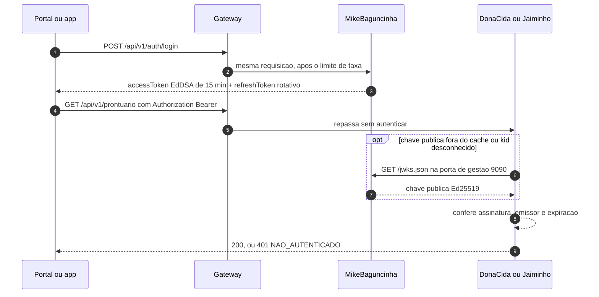
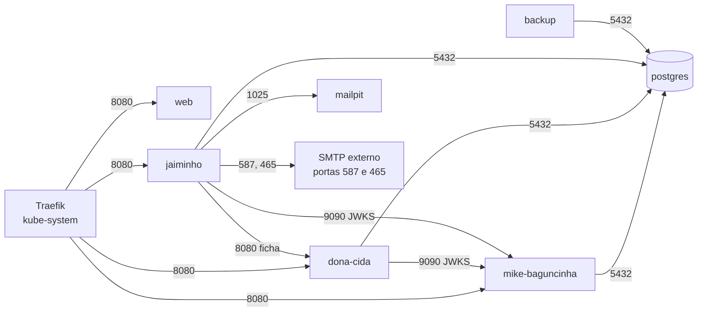

# Segurança, auditoria e LGPD

O que o MedicalField faz para autenticar, autorizar, registrar e proteger — **como está implementado**, com o arquivo de cada medida e os limites declarados.

Relacionados: [`arquitetura.md`](arquitetura.md) · [`sincronizacao.md`](sincronizacao.md) · [`../dados/modelagem.md`](../dados/modelagem.md).

## 1. Autenticação

### Login

`POST /api/v1/auth/login` é a **única rota sem token** (`apps/mike-baguncinha/internal/http/servidor.go`). O profissional se identifica pelo registro profissional, como o enunciado pede:

| Campo | Valores |
| --- | --- |
| `tipoRegistro` | `CRM`, `COREN` ou `SOCORRISTA` |
| `registro` | número do conselho ou identificação do socorrista |
| `uf` | obrigatória para CRM e COREN; vazia para socorrista |
| `senha` | — |

- **Senha:** Argon2id (19 MiB, 2 iterações, 1 *thread* — o mínimo recomendado pela OWASP), no formato PHC, comparada em tempo constante (`internal/infra/senha.go`).
- **Não revela se o registro existe:** quando o profissional não é encontrado, um *hash* falso é verificado mesmo assim, para o tempo de resposta ser o mesmo; a mensagem é sempre "Registro ou senha inválidos" (`internal/aplicacao/autenticacao.go`).
- **Limite de tentativas, em duas camadas:**
  - no serviço: 5 falhas em 15 min para o mesmo IP + registro → 429 (`internal/aplicacao/limitador.go`);
  - no gateway: 10 requisições por minuto por IP na rota de login (`deploy/base/gateway/middlewares.yaml`, `limite-login`).

### Tokens

| | *Access token* | *Refresh token* |
| --- | --- | --- |
| Formato | JWT assinado com **EdDSA (Ed25519)**, cabeçalho com `kid` | Opaco, 32 bytes aleatórios |
| Validade | 15 min | 30 dias, **rotativo** |
| Guardado no servidor | Não (validação pela assinatura) | Só o **SHA-256** (`identidade.sessao.refresh_hash`) |
| Código | `internal/infra/token.go` | `internal/aplicacao/autenticacao.go`, `internal/infra/postgres.go` (`Rotacionar`) |

Claims do JWT: `iss` = `medicalfield`, `sub` (id do profissional), `nome`, `tipoRegistro`, `registro`, `uf`, `papel`, `iat`, `exp`, `jti`.

A rotação é **um único comando SQL**: o `UPDATE` que revoga a sessão antiga trava a linha, então duas renovações simultâneas do mesmo token nunca passam as duas.

### JWKS: cada serviço valida sozinho

Só o MikeBaguncinha tem a chave privada. Ele publica a chave pública em `GET /jwks.json`, na **porta de gestão (9090)** — que não é roteada pelo gateway (pelo gateway, `/jwks.json` responde 404).



| Serviço | Validação | Cache da chave |
| --- | --- | --- |
| MikeBaguncinha | Com a própria chave pública (`token.go`, `Validar`) | — |
| DonaCida | `jose` — `apps/dona-cida/src/infra/verificador-token.ts`; aplicada como *guard* global (`src/http/cadeia.ts`, `AutenticacaoGuard`) | 5 min; `kid` desconhecido dispara nova busca |
| Jaiminho | PyJWT — `apps/jaiminho/src/jaiminho/infra/jwks.py`; aplicada como middleware (`http/middlewares.py`, `AutenticacaoMiddleware`) | 5 min |

Os três conferem algoritmo (`EdDSA` apenas), emissor e expiração. O **gateway não autentica**: é defesa em profundidade, e é o que o enunciado exige ("todos os serviços").

Por que EdDSA + JWKS e não um segredo compartilhado (HS256): com segredo compartilhado, qualquer serviço que valida também conseguiria **emitir** token.

`POST /auth/refresh` não leva *access token*, mas exige *refresh token* válido — não é rota anônima.

### Onde a sessão fica no cliente

| | Portal (BradPitt) | App (LuckyPatcher) |
| --- | --- | --- |
| *Access token* | Só em memória (`apps/brad-pitt/src/api/cliente.ts`) | No banco local (`sync_estado`, chave `sessao`) |
| *Refresh token* | Cookie `mf_refresh`: `HttpOnly`, `SameSite=Strict`, `Path=/api/v1/auth`, `Secure` em produção | No banco local, junto com a sessão |
| Por quê | O JavaScript nunca vê o *refresh token* | O app **precisa abrir sem rede** (`apps/lucky-patcher/src/sync/sessao.ts`) |
| Em 401 | Renova uma vez pelo cookie e repete | Renova uma vez e repete; se recusado, marca "precisa de login" e **mantém a fila** |

**Uso offline:** o primeiro login exige rede. Depois, o app abre e registra sem rede com a sessão local; o token só importa na hora de sincronizar.

## 2. Autorização

Dois papéis, no claim `papel`:

| Papel | Quem | Pode |
| --- | --- | --- |
| `PROFISSIONAL` | Enfermeiro, socorrista, médico em campo | Todas as rotas clínicas e de documentos |
| `ADMIN` | Administrador do portal | Tudo acima + `GET /auditoria/acesso` e `GET /auditoria/cliente` |

- As rotas `/auditoria/*` exigem `ADMIN`; papel insuficiente → 403 `SEM_PERMISSAO` (`servidor.go`, `autenticar(dominio.PapelAdmin, ...)`).
- No portal, as telas de auditoria ficam atrás de `RequerAdmin` (`apps/brad-pitt/src/sessao/sessao.tsx`) — mas a regra que vale é a do servidor.
- Rota inexistente sob `/api/v1` também exige token: 401 antes do 404.

Não existe credencial de serviço. A única chamada entre serviços (Jaiminho → DonaCida) **repassa o JWT do usuário** (`apps/jaiminho/src/jaiminho/infra/clinico.py`): não há segredo a vazar e o log de acesso da DonaCida registra o profissional real.

## 3. Os quatro tipos de registro

São coisas diferentes, com finalidades e garantias diferentes.

| Tipo | Responde a | Conteúdo | Onde | Garantia |
| --- | --- | --- | --- | --- |
| **Log operacional** | "Por que deu erro?" | Nível, mensagem, `requestId`, classe do erro | stdout, JSON em uma linha | Sem corpo, senha, token ou dado de paciente |
| **Log de acesso** | "Quem acessou o quê?" | Os 7 campos do enunciado + serviço + `request_id` | stdout **e** `auditoria.log_acesso` | Somente inserção; gravação assíncrona |
| **Auditoria clínica** | "Quem criou ou alterou este dado de saúde?" | Entidade, ação, autor, dispositivo, antes/depois, observação | `clinico.auditoria_clinica` | **Mesma transação** do dado; somente inserção |
| **Registro de sincronização** | "O que subiu, de onde e quando?" | Comando recebido (`operacao_sync`) e ações feitas no aparelho (`log_cliente`) | `clinico.operacao_sync`, `auditoria.log_cliente` | Somente inserção; idempotente |

### Log de acesso — o requisito do enunciado

Uma linha por requisição em `/api/v1/*`, em **todos** os serviços:

| Campo do enunciado | Coluna em `auditoria.log_acesso` | Campo no stdout |
| --- | --- | --- |
| Data_hora | `data_hora` | `dataHora` |
| IP do Cliente | `ip_cliente` | `ipCliente` |
| ID do Profissional Autenticado | `profissional_id` (nulo se a requisição não autenticou) | `profissionalId` |
| Método HTTP | `metodo` | `metodo` |
| Rota | `rota` | `rota` |
| Status Code | `status_code` | `statusCode` |
| Tempo de Processamento (ms) | `tempo_ms` | `tempoMs` |
| (a mais) | `servico`, `request_id` | `servico`, `requestId` |

Linha real, do stdout da DonaCida no cluster local:

```json
{"nivel":"info","tipo":"acesso","dataHora":"2026-11-18T03:07:13.577Z","servico":"dona-cida","ipCliente":"172.30.77.1","profissionalId":"0d5b1c1e-7a10-4c1e-9b11-000000000002","metodo":"POST","rota":"/api/v1/atendimento","statusCode":201,"tempoMs":9,"requestId":"4109aacc-637a-4fe5-9f9a-8a53a4072c5b"}
```

Como é feito — a cadeia `request-id → log de acesso → autenticação → handler` (padrão *Chain of Responsibility*):

| Serviço | Middleware | Gravador assíncrono |
| --- | --- | --- |
| MikeBaguncinha | `internal/http/servidor.go` (`logAcesso`) | `internal/infra/gravador_acesso.go` |
| DonaCida | `src/http/cadeia.ts` (`LogAcessoMiddleware`) | `src/infra/log-acesso.ts` |
| Jaiminho | `src/jaiminho/http/middlewares.py` (`LogAcessoMiddleware`) | `src/jaiminho/infra/log.py` (`BufferLogAcesso`) |

- O log **envolve** a autenticação: um 401 também é registrado, com profissional nulo.
- `rota` é o **padrão** da rota (`/api/v1/prontuario/{pessoaId}`), nunca o caminho com ids nem a *query string*.
- A gravação no banco é em lote (a cada 1 s ou 100 linhas, e no encerramento). Uma falha ao gravar nunca derruba a requisição — a linha já saiu no stdout.
- **Limite aceito:** se o processo morrer sem `SIGTERM`, até cerca de 1 s de linhas pode não chegar ao banco. Isso vale só para o log de acesso; a auditoria clínica é transacional e não tem essa janela.
- **Defeito conhecido (D-04, baixa):** em alguns 401 sem token, o Jaiminho grava `rota: "(rota desconhecida)"`.

Consulta: no portal, "Logs de acesso" (ADMIN); pela API, `GET /api/v1/auditoria/acesso?de=&ate=&profissionalId=&servico=`; por SQL:

```sql
SELECT data_hora, servico, ip_cliente, profissional_id, metodo, rota, status_code, tempo_ms
FROM auditoria.log_acesso ORDER BY data_hora DESC LIMIT 20;
```

### Somente inserção é regra do banco, não do código

As migrações rodam como **administrador**; cada serviço usa um papel restrito que **não é dono** das tabelas. Para as tabelas de trilha, o papel só recebe `SELECT, INSERT`:

| Tabela | Papel | Privilégio |
| --- | --- | --- |
| `auditoria.log_acesso` | `mf_mike` | `SELECT, INSERT` |
| `auditoria.log_acesso` | `mf_cida`, `mf_jaiminho` | `INSERT` apenas (nem leem) |
| `auditoria.log_cliente` | `mf_mike` | `SELECT, INSERT` |
| `clinico.atendimento_evento`, `clinico.operacao_sync`, `clinico.auditoria_clinica` | `mf_cida` | `SELECT, INSERT` |
| `documentos.documento` | `mf_jaiminho` | `SELECT, INSERT` |

Um `UPDATE` ou `DELETE` nessas tabelas falha no Postgres mesmo que o código do serviço tente (teste: "a linha do tempo é imutável", em `apps/dona-cida/tests/integracao.test.ts`). Tabela completa em [`../dados/modelagem.md`](../dados/modelagem.md).

Corrigir um evento clínico é **acrescentar** um evento `RETIFICACAO` apontando para o original — o original continua lá.

## 4. IP do cliente

O serviço fica atrás do gateway, então o par direto da conexão é o Traefik. A regra, igual nos três serviços:

> Se o par direto está em `PROXIES_CONFIAVEIS`, vale o IP **mais à direita** de `X-Forwarded-For` que **não** seja um proxy confiável. Caso contrário, vale o par direto e o cabeçalho é ignorado.

| Serviço | Arquivo |
| --- | --- |
| MikeBaguncinha | `internal/http/ip.go` (`IPCliente`) |
| DonaCida | `src/http/ip-cliente.ts` (`resolverIpCliente`) |
| Jaiminho | `src/jaiminho/http/middlewares.py` (`ip_do_cliente`) |

- `PROXIES_CONFIAVEIS` no cluster: `127.0.0.1/32, ::1/128, 10.42.0.0/16` — a rede de pods do k3s, onde está o Traefik (`deploy/base/kustomization.yaml`).
- O Traefik só aceita `X-Forwarded-For` vindo de `127.0.0.1` e roda com `externalTrafficPolicy: Local`, para enxergar o IP de origem (`deploy/argocd/traefik-helmchartconfig.yaml`).
- Um cliente que forje o cabeçalho não engana o log: o Traefik o descarta, e o serviço só confia no que veio do Traefik.

Observado no cluster local (E-004): as chamadas externas registram `172.30.77.1` — o endereço real visto pelo nó, que é o gateway da rede Docker onde o k3s roda; a chamada interna Jaiminho → DonaCida registra o IP do pod. A forja de cabeçalho é coberta por teste de unidade (`internal/http/ip_test.go`), não por teste no cluster.

## 5. LGPD

Dado de saúde é dado pessoal sensível (LGPD, art. 5º, II). O enquadramento jurídico do tratamento (art. 11) deve ser confirmado com quem orienta o trabalho — o software não decide base legal.

### Medidas implementadas

| Princípio | Medida | Onde |
| --- | --- | --- |
| Segurança | Autenticação em toda rota; senha em Argon2id; token de curta duração | Seção 1 |
| Responsabilização | Log de acesso de toda requisição; trilha clínica com antes/depois; registro de quem enviou a ficha, para quem e com qual vínculo | Seção 3; `documentos.envio_email` |
| Minimização | O app baixa cadastros, **não** atendimentos de outros aparelhos | `GET /sync/alteracoes` (`alteracoesDesde`) |
| Minimização nos logs | Nenhum log contém corpo, senha, token ou dado de paciente; o erro de SMTP guarda só a classe do erro (a mensagem do servidor pode citar o destinatário) | `aplicacao/envios.py` |
| Minimização no e-mail | O corpo do e-mail não traz dado clínico: o conteúdo vai só no anexo | `dominio/regras.py` (`montar_mensagem`) |
| Segregação | Um schema e um papel de banco por serviço | `deploy/db/schemas.sql`, migrações |
| Integridade | Linha do tempo e trilhas somente inserção; PDF guardado com SHA-256 e código de verificação | `documentos.documento` (`hash_pdf`) |
| Dados de teste | Nenhum dado real: pessoas, profissionais e registros de conselho são inventados | Migrações `..._dados_demo.sql`, `..._profissionais_demo.sql` |

### Limites declarados

- **O banco local no navegador não é cifrado.** Fica no OPFS da origem, protegido só pelo perfil do navegador. O cliente web serve à demonstração e a ambiente controlado. No Android o adaptador usa SQLCipher com segredo no armazenamento seguro do sistema — validado em **emulador** (o arquivo `databases/medicalfieldSQLite.db` não traz o cabeçalho SQLite em claro; E-008), não em aparelho físico.
- **A sessão do app (inclusive o *refresh token*) fica nesse mesmo banco local.**
- **Todas as pessoas descem para o aparelho.** Serve ao porte acadêmico; em produção seria preciso recortar por base ou região e prever limpeza remota.
- **Sem TLS no ambiente validado** — inclusive do app Android até o gateway local. O cluster local atende em `http://localhost:8088`. HTTPS depende do acesso público na VM, documentado em [`../operacao/acesso-publico.md`](../operacao/acesso-publico.md) e não executado. `Secure` no cookie e HSTS só valem em HTTPS.
- **Sem exclusão nem anonimização de titular.** Retenção legal de prontuário e base legal do envio por e-mail não são decididas pelo software.
- **Reutilizar um *refresh token* já rotacionado** é apenas recusado (401); as outras sessões do profissional não são revogadas.
- **O limite de tentativas de login** fica em memória, por processo.
- **Fusão de pessoas duplicadas não existe** — só a sinalização para revisão humana.

## 6. Segurança no Kubernetes

| Medida | Como | Arquivo |
| --- | --- | --- |
| Contêiner sem root | `runAsNonRoot`, uid sem privilégio (10001 nos serviços, 101 no nginx, 70 no Postgres) | `deploy/base/*/deployment.yaml` |
| Raiz somente leitura | `readOnlyRootFilesystem: true`; `/tmp` em `emptyDir` limitado | idem |
| Sem privilégios | `allowPrivilegeEscalation: false`, `capabilities.drop: ["ALL"]`, `seccompProfile: RuntimeDefault` | idem |
| Sem token da API do cluster | `automountServiceAccountToken: false` | idem |
| Limite de memória | `resources.limits.memory` em todo contêiner | idem |
| Rede negada por padrão | `negar-tudo` + uma liberação por caminho real | `deploy/base/networkpolicies/networkpolicies.yaml` |
| Porta de gestão isolada | 9090 fora do `Ingress`; só o kubelet e (no Mike) os dois serviços que buscam o JWKS | `ingress.yaml`, `networkpolicies.yaml` |
| Segredos fora do Git | `Secret` criado por script; senhas e chave Ed25519 geradas na máquina | `deploy/scripts/criar-secrets.sh`, `deploy/secrets.env.example` |
| Migração separada do serviço | `initContainer` com credencial de administrador; o contêiner do serviço só tem o papel restrito | `deploy/base/*/deployment.yaml` |
| Cabeçalhos no gateway | `X-Content-Type-Options`, `X-Frame-Options: DENY`, `Referrer-Policy`, `Permissions-Policy`, HSTS | `deploy/base/gateway/middlewares.yaml` |
| CSP nos front-ends | `default-src 'self'`; `wasm-unsafe-eval` só para o SQLite do app | `deploy/web/nginx.conf` |
| Backup | `pg_dump` diário, 7 cópias | `deploy/base/backup/cronjob.yaml` |

Caminhos de rede liberados pelas NetworkPolicies:



O que não está nesse desenho é negado — por exemplo, `web` e `mailpit` não alcançam o Postgres. **Situação:** as políticas foram aplicadas e o sistema funciona com elas; o teste de bloqueio (tentar um caminho proibido) foi relatado uma vez e não repetido de forma independente (item K8-07 da matriz).

## 7. Conteúdo clínico: o que é demonstrativo

O MedicalField **registra** o que o profissional informa. Ele não interpreta, não alerta e não sugere.

| Categoria | Itens | Tratamento |
| --- | --- | --- |
| **Demonstrativo** | Catálogo de medicamentos, pacientes, profissionais, registros de conselho | Tudo fictício. A faixa "DADOS DEMONSTRATIVOS — SEM VALIDADE CLÍNICA" aparece nas telas e em todas as páginas do PDF. |
| **Só registro da escolha do profissional** | Componentes do Glasgow; classificações de Manchester e START; unidades e vias | O sistema guarda o valor escolhido. O total do Glasgow é a soma (`packages/dominio`); nenhuma cor de triagem vem pré-marcada. O fluxograma de Manchester é material licenciado e **não é reproduzido**. |
| **Limites de digitação** | Faixas de sinais vitais (ex.: pressão sistólica 0–300) | Apenas plausibilidade de digitação — **não** são faixas de normalidade (`packages/contratos/src/cida.ts`). |
| **Não implementado, de propósito** | Alerta de alergia, regra de dose, interação medicamentosa, sugestão de conduta | Exigiria validação por profissionais de saúde e referência autorizada. |

O catálogo de medicamentos traz só nome genérico e forma de apresentação — sem dose, indicação ou contraindicação (`apps/dona-cida/migrations/20261117000250_dados_demo.sql`).

## 8. Onde cada requisito de segurança do enunciado é atendido

| Requisito | Atendimento |
| --- | --- |
| "Todas as rotas (com exceção da rota de login) exigem autenticação" | Seção 1; validado nos três serviços pelo gateway (E-004) e pela requisição "Sem token: 401" da coleção Postman |
| "Credenciais do profissional de saúde (CRM, COREN ou ID de Socorrista)" | `tipoRegistro` + `registro` + `uf`; três profissionais de demonstração, um de cada tipo |
| "Middleware/interceptor que registre logs detalhados de acesso a cada requisição" | Seção 3; os 7 campos, nos três serviços |
| "Rastreabilidade auditável" | `auditoria_clinica`, `operacao_sync`, `log_cliente` |
| "Idempotência" e "tratamento de conflitos" | [`sincronizacao.md`](sincronizacao.md), seções 6 e 8 |
