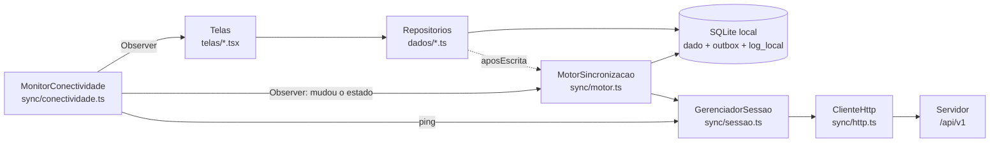
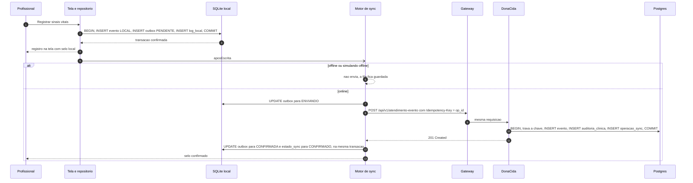
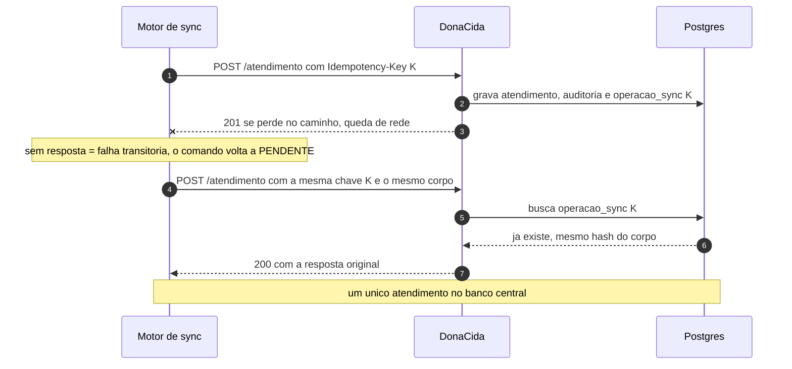
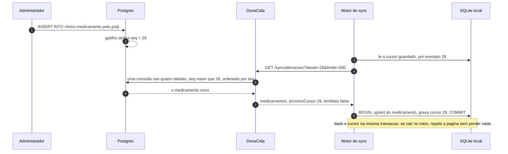
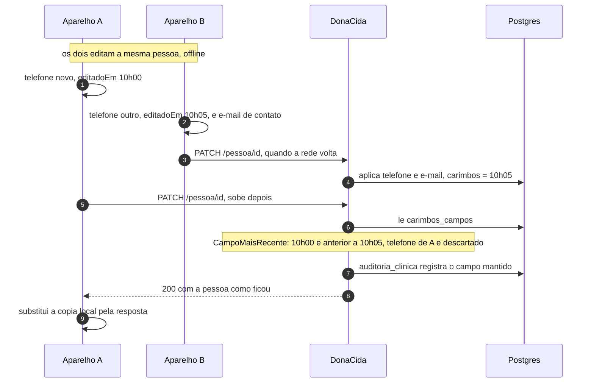

# Sincronização Offline-First

Como o MedicalField registra sem rede e sincroniza depois — **como está implementado**. Cada afirmação aponta o arquivo que a implementa. Caminhos sem prefixo são relativos a `apps/lucky-patcher/src/`; os do servidor, a `apps/dona-cida/src/`.

Visão geral do sistema: [`arquitetura.md`](arquitetura.md). Tabelas: [`../dados/modelagem.md`](../dados/modelagem.md).

## 1. Princípio

> A tela nunca fala com a rede. Ela grava no banco local e o motor de sincronização cuida do resto.

Consequências práticas:

- Online e offline usam **o mesmo caminho de escrita**. "Estar online" só muda quanto tempo o comando fica na fila.
- Um registro aparece na tela assim que a transação local confirma, com um selo de estado (local → enviando → confirmado, ou rejeitado).
- Toda entrega é **ao menos uma vez**, com **receptor idempotente** no servidor: reenviar é sempre seguro.



## 2. Escrita local transacional

Cada ação do profissional vira **uma transação** no SQLite, com três coisas juntas: a linha do dado (`estado_sync = 'LOCAL'`), o comando no `outbox` e a linha de auditoria em `log_local`.

| O quê | Onde |
| --- | --- |
| Porta do banco: `transacao(comandos)` — "ou tudo entra, ou nada" | `banco/executor.ts` (`ExecutorSql`) |
| Criar pessoa + prontuário + itens em um `gravar` | `dados/pessoas.ts` (`RepositorioPessoas.criar`) |
| Iniciar atendimento e registrar evento | `dados/atendimentos.ts` (`iniciar`, `registrarEvento`) |
| O comando gravado junto com o dado | `dados/outbox.ts` (`sqlNovoComando`) |
| Validação antes de gravar, com o **mesmo esquema zod** do servidor | `dados/contexto.ts` (`validar`) + `packages/contratos` |
| Falha de gravação é erro bloqueante, nunca "salvo" falso | `banco/executor.ts` (`ErroBancoLocal`) |

Durabilidade no navegador: o banco é o SQLite WASM oficial gravando em OPFS, com `PRAGMA synchronous=FULL` (`banco/sqlite.worker.ts`). O `COMMIT` só retorna depois do *flush* — fechar a aba em seguida não perde nada. Medido em `apps/lucky-patcher/docs/durabilidade.md`: 5 de 5 rodadas duráveis matando o processo do Chrome logo após a transação.

Os ids (pessoa, prontuário, atendimento, evento) são **UUIDs gerados no dispositivo** — é o que permite criar uma cadeia inteira de registros sem falar com o servidor.

## 3. Outbox

A tabela `outbox` (`banco/migracoes/001_inicial.sql`) é a fila de envio. Cada linha é um **comando** serializável (padrão Command):

| Coluna | Função |
| --- | --- |
| `ordem` | Autoincremento: a ordem de criação é a ordem de envio. |
| `op_id` | UUID do comando; vai como `Idempotency-Key`. |
| `metodo`, `rota`, `corpo` | A requisição inteira, pronta para reenviar. |
| `entidade`, `entidade_id` | A que linha local o comando se refere. |
| `depende_de` | `tabela:id` da entidade que precisa existir no servidor antes. |
| `status` | `PENDENTE` → `ENVIANDO` → `CONFIRMADA`, ou `REJEITADA`. |
| `tentativas`, `recuo`, `proxima_tentativa_em`, `ultimo_erro` | Controle de retentativa. |
| `profissional_id` | O outbox é por profissional. |

A função `classificarFila` (`dados/outbox.ts`) percorre a fila em ordem e dá a cada comando uma situação:

- `ENVIAVEL` — pode subir agora;
- `REJEITADA` — o servidor recusou (4xx);
- `RETIDA` — depende de algo rejeitado ou retido; **não é enviada nem descartada**;
- `DE_OUTRO_PROFISSIONAL` — pertence a outro login; espera o dono voltar.

Comandos **independentes** de uma rejeição continuam enviáveis: uma pessoa recusada não trava o atendimento de outra.

## 4. Monitor de conectividade e simulador

`MonitorConectividade` (`sync/conectividade.ts`) publica **um único estado**:

```
online = (não está simulando offline) E (servidor alcançável)
```

- **Servidor alcançável** vem de um *ping* autenticado (`GET /api/v1/auth/me`) feito pelo cliente HTTP único — a cada 20 s quando online e a cada 5 s quando fora (`app.ts`, `conectividade.ts`). Resposta 5xx conta como servidor fora (`sync/http.ts`, `servidorRespondeu`).
- Os eventos `online`/`offline` do navegador e a volta ao primeiro plano antecipam a verificação (`main.tsx`).
- **O seletor "Simular offline"** (a chave na tira permanente do topo e o seletor "Simular conectividade" em Ajustes) chama `app.simularOffline` → `monitor.definirSimulacao`. O valor é **persistido** em `sync_estado.modo_simulado` antes de valer, então sobrevive a recarregar o app.
- Com a simulação ligada, o `ClienteHttp` **recusa a chamada antes de sair** (`FalhaTransporte('OFFLINE_SIMULADO')`, `sync/http.ts`): nenhuma requisição aparece na aba de rede. O próprio *ping* também não é emitido.
- Ao desligar a simulação, o monitor **não presume** que está online: só publica `online` depois de o *ping* confirmar.

É o padrão **Observer**: `assinar(ouvinte)` / `publicar(mudanca)`. Dois assinantes:

1. o `MotorSincronizacao` (`sync/motor.ts`, `iniciar`) — quando o estado passa de fora para online, zera o recuo e chama `sincronizar('conexao')`;
2. a interface (`ui/contexto.tsx`, `useConectividade`) — a tira "Online / Offline" e os textos da tela.

Gatilhos de sincronização (`Gatilho` em `motor.ts`): `abertura`, `conexao`, `primeiro-plano`, `manual` (botão "Sincronizar agora"), `temporizador` (recuo vencido) e `escrita` (comando novo no outbox).

## 5. Subida (dispositivo → central)

`MotorSincronizacao.subir` (`sync/motor.ts`) envia **um comando por requisição, na ordem de criação**. O progresso parcial fica salvo a cada comando.



O que o motor faz com cada resposta (`subir`):

| Resultado | Ação |
| --- | --- |
| **2xx** | `CONFIRMADA`; a linha local passa a `estado_sync = 'CONFIRMADO'` na mesma transação (`sqlConfirmar`). Segue para o próximo. |
| **Rede, *timeout* ou 5xx** | Transitório: volta a `PENDENTE` com recuo exponencial e *jitter* — 1 s, 2 s, 4 s… teto de 5 min (`calcularRecuoMs`). A subida **para**: nada passa na frente (a ordem é parte do contrato). |
| **4xx** | Rejeição definitiva: `REJEITADA`, com o motivo do servidor em `ultimo_erro`. Segue para o próximo comando enviável; os dependentes ficam `RETIDA`. |
| **401** | `GerenciadorSessao.requisitar` (`sync/sessao.ts`) renova o token e repete uma vez. Se a renovação for recusada, a sessão fica "precisa de login" e **o outbox fica intacto**. |
| **Simulação ligada no meio** | Devolve o comando à fila sem contar tentativa nem recuo. |

A regra "4xx é definitivo, rede/5xx é transitório" está em `packages/contratos/src/erros.ts` (`ehFalhaTransitoria`).

Depois da subida, na mesma passagem, o motor envia os logs locais (`enviarLogs` → `POST /api/v1/log`, em lotes de até 500; só apaga do aparelho após a confirmação) e faz a descida.

Nunca há duas sincronizações ao mesmo tempo: uma segunda chamada devolve a mesma promessa e marca que é preciso passar de novo ao terminar (`sincronizar`).

### Tela de Pendências

`telas/Pendencias.tsx` + `dados/pendencias.ts` mostram a fila e as rejeitadas com o motivo. O profissional pode **tentar de novo** (mesma chave de idempotência), **corrigir** o cadastro rejeitado ou **descartar** — o descarte remove o comando, os que dependem dele em cadeia e o registro que só existia neste aparelho, e fica em log. É o único ponto do app que apaga registro.

## 6. Idempotência no servidor

Receptor idempotente: `ExecutorComandos` (`aplicacao/comando.ts`). Todas as rotas `POST`/`PATCH` da DonaCida passam por ele. Dentro de **uma transação**:

1. trava a chave (`travarChave`) — dois comandos simultâneos com a mesma `Idempotency-Key` ficam em fila;
2. procura a chave em `clinico.operacao_sync`;
3. se existe com o **mesmo** *hash* do corpo → devolve **200 com a resposta original**, sem tocar em nada;
4. se existe com corpo **diferente** → 422 `CHAVE_IDEMPOTENCIA_CONFLITANTE`;
5. senão, executa a ação (dado + `auditoria_clinica`) e grava `operacao_sync` com o status e a resposta.

Dado, auditoria e registro de sincronização entram **juntos ou não entram**.

Segunda linha de defesa, sem chave: como o id da entidade vem do cliente, um `POST` com id já existente devolve 200 com o registro existente (`aplicacao/pessoa.ts`, `atendimento.ts`, `prontuario.ts`).



Validado: E-002 (mesmo `POST` duas vezes → 1 linha), E-006 cenário 6 (resposta perdida) e passo 14 do roteiro (duas sincronizações extras sem duplicata).

## 7. Descida (central → dispositivo)

O app baixa os **cadastros** — medicamentos, pessoas, prontuários e itens — por cursor. Atendimentos **não descem**: cada aparelho só tem os que ele mesmo registrou (minimização de dados).

**O cursor `seq`.** Toda linha dessas quatro tabelas tem a coluna `seq`. Um gatilho `BEFORE INSERT OR UPDATE` (`clinico.marcar_alteracao`, em `apps/dona-cida/migrations/20261117000200_clinico.sql`) atribui a cada escrita o próximo valor de **uma sequência global** — inclusive em `INSERT` manual pelo `psql`. É por isso que o medicamento inserido no passo 9 do roteiro chega ao app. Detalhes em [`../dados/modelagem.md`](../dados/modelagem.md).



| O quê | Onde |
| --- | --- |
| A consulta: **uma** instrução = um *snapshot* das quatro tabelas | `infra/repositorio-clinico.ts` (`alteracoesDesde`) |
| Rota e validação (`desde`, `limite` até 1000) | `http/controllers.ts` (`SyncController`), `packages/contratos/src/cida.ts` |
| Laço de páginas no app, com dado + cursor na mesma transação | `sync/motor.ts` (`descer`) |
| **Linha com pendência local não é sobrescrita** pela descida | `sync/motor.ts` (`semPendencia`) |

A última regra evita que uma cópia antiga do servidor apague o que o profissional acabou de editar e ainda não subiu.

## 8. As quatro estratégias de conflito

Padrão **Strategy** em `dominio/conflito/`. A interface é `EstrategiaConflito` (`estrategia.ts`): uma função pura que recebe "o que o servidor tem" e "o que chegou" e devolve a decisão; quem grava é o caso de uso. `registro.ts` escolhe a estratégia pelo tipo de dado.

| Dado | Estratégia | Regra | Arquivo | Usada em |
| --- | --- | --- | --- | --- |
| Eventos do atendimento, itens do prontuário | `UniaoImutavel` | Cada registro tem UUID próprio; o resultado é a **união**. O que já existe nunca é alterado nem removido por uma cópia antiga. | `uniao-imutavel.ts` | `aplicacao/atendimento.ts` (`gravarEventos`), `aplicacao/prontuario.ts` |
| Dados cadastrais da pessoa | `CampoMaisRecente` | Vence, **campo a campo**, a edição com `editadoEm` mais recente, comparada com `carimbos_campos`. Empate mantém o servidor. O valor anterior vai para `auditoria_clinica.antes`. | `campo-mais-recente.ts` | `aplicacao/pessoa.ts` (`AlterarPessoaUseCase`) |
| Medicamento (cadastro de apoio) | `ServidorVence` | O cliente só lê. Um `medicamentoId` que o servidor não conhece não rejeita o evento: ele é gravado como "fora do catálogo". | `servidor-vence.ts` | `aplicacao/atendimento.ts`; no app, a descida sobrescreve (`descer`) |
| Pessoa provavelmente duplicada | `RevisaoManual` | Mesmo CPF, ou mesmo nome + nascimento: **aceita** e preenche `possivel_duplicata_de`. Nunca rejeita nem funde sozinha. | `revisao-manual.ts` | `aplicacao/pessoa.ts` (`CadastrarPessoaUseCase`) |

Regra que atravessa as quatro: **dado clínico nunca é rejeitado por conflito cadastral**. Rejeição (422) só por corpo inválido ou referência inexistente.

Duas regras ligadas:

- **Prontuário por pessoa.** O atendimento referencia `pessoaId`; o servidor resolve o prontuário e cria um vazio se não existir (`aplicacao/prontuario.ts`, `resolverProntuario`). `POST /prontuario` para quem já tem devolve 200 com o existente, unindo os itens; o app troca o id local pelo do servidor (`sync/motor.ts`, `sqlConfirmar`).
- **Relógio do dispositivo.** Horário mais de 5 min à frente do servidor é limitado ao horário do servidor e anotado em `auditoria_clinica.observacao`; horário no passado nunca é alterado (`dominio/relogio.ts`).



**Limite honesto:** as quatro estratégias são cobertas por testes de integração da DonaCida contra Postgres real (`apps/dona-cida/tests/integracao.test.ts`), mas o cenário acima **não foi executado com dois aparelhos reais** (itens OF-12 a OF-14 da matriz de validação).

## 9. Cenários de falha

| Situação | Comportamento | Onde | Validado em |
| --- | --- | --- | --- |
| Sem rede ou servidor fora | Tudo local continua; a fila acumula; a tira mostra "N pendentes". | `sync/motor.ts` (`executar`) | E-006, roteiro passo 12 |
| App fechado no meio do envio | Na abertura, `ENVIANDO` volta a `PENDENTE`; o reenvio é seguro pela idempotência. | `motor.ts` (`iniciar`) | E-006 cenário 6 |
| Resposta perdida | O reenvio recebe 200 com o resultado original. | `aplicacao/comando.ts` | E-006 cenário 6 |
| Subida interrompida (1 de 5 enviados) | O confirmado fica confirmado; o resto segue depois. | `motor.ts` (`subir`) | E-006 cenário 6 |
| Operação rejeitada (4xx) | Vai para Pendências com o motivo; dependentes retidos; independentes sobem. | `dados/outbox.ts` (`classificarFila`) | E-006 cenário 7 (422 injetado por interceptação) |
| Token expirado | Renova e segue; renovação recusada → pede login, **fila intacta**, e o app continua registrando. | `sync/sessao.ts` | Testes do motor (`sync/sync.test.ts`) |
| Outro profissional no mesmo aparelho | A fila é por profissional; sair com pendências pede confirmação. | `telas/Ajustes.tsx`, `dados/pendencias.ts` | Testes do motor |
| Medicamento ainda não baixado | Texto livre; evento "fora do catálogo". | `telas/PaineisRegistro.tsx`, `aplicacao/atendimento.ts` | E-006 |
| Falha de gravação local | Transação desfeita, erro explícito na tela. | `banco/executor.ts` | Testes do motor (`sync/sync.test.ts`, T-15) |
| Duas abas do app | A segunda mostra "já está aberto em outra aba" (Web Lock). | `plataforma.ts` | — |
| Navegador sem OPFS | Tela "Não foi possível abrir o banco local"; não existe recuo para memória. | `banco/executorWeb.ts` | — |

## 10. Auditoria da sincronização

Dois registros, em lados diferentes:

- **No aparelho:** `log_local` guarda login, criação de registro, troca do seletor, tentativa de sincronização e descartes, com a hora do dispositivo e se estava online (`dados/outbox.ts`, `sqlLog`). Sobe por `POST /log`, idempotente por `id`, e vira `auditoria.log_cliente`. Nunca leva dado de paciente.
- **No servidor:** `clinico.operacao_sync` guarda cada comando recebido — de quem, de qual dispositivo, qual rota, *hash* do corpo, status e resposta.

Consulta no portal: "Logs de acesso" (ADMIN). Pela API: `GET /api/v1/auditoria/cliente`.

## 11. Limites conhecidos

- Atendimentos de outros aparelhos não aparecem no app; a visão consolidada é a do portal.
- O banco local no **navegador não é cifrado**; no Android o adaptador usa SQLCipher — conferido em emulador (o arquivo do banco não tem o cabeçalho SQLite em claro; E-008), não em aparelho físico.
- Uma aba por vez; no navegador, medido só no Chrome para desktop.
- No Android, o ciclo offline → processo morto → reabertura → sincronização foi validado em emulador (`e2e/android/android.mjs`); os cenários de queda no meio da subida e de resposta perdida só foram exercitados no navegador.
- Não há fusão de pessoas duplicadas — só a sinalização.
- O cursor usa uma trava global para que `seq` siga a ordem de *commit*; serve ao porte do trabalho (comentário `ponytail:` na migração indica o caminho se a vazão crescer).
