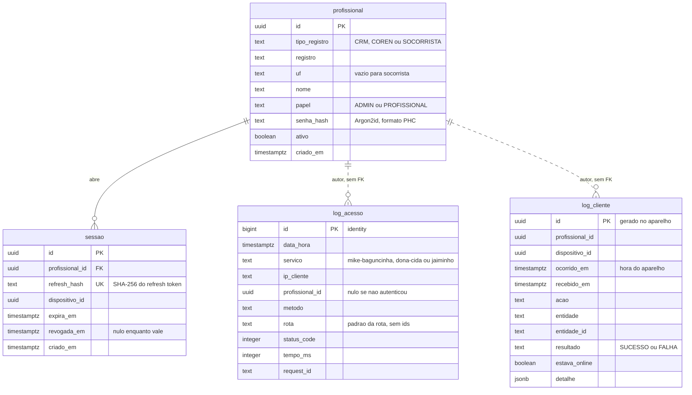
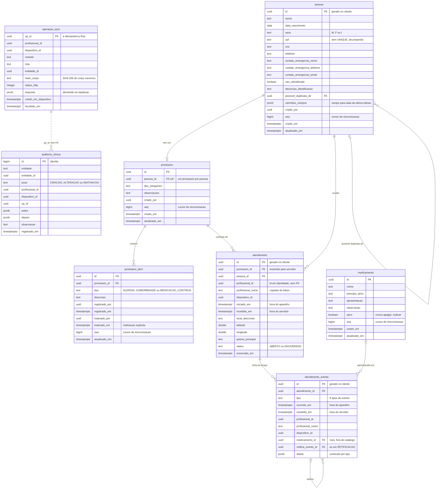
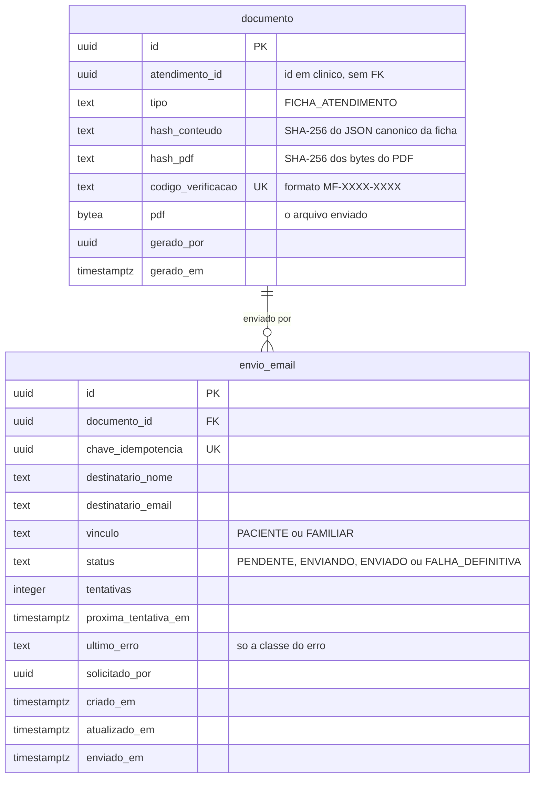
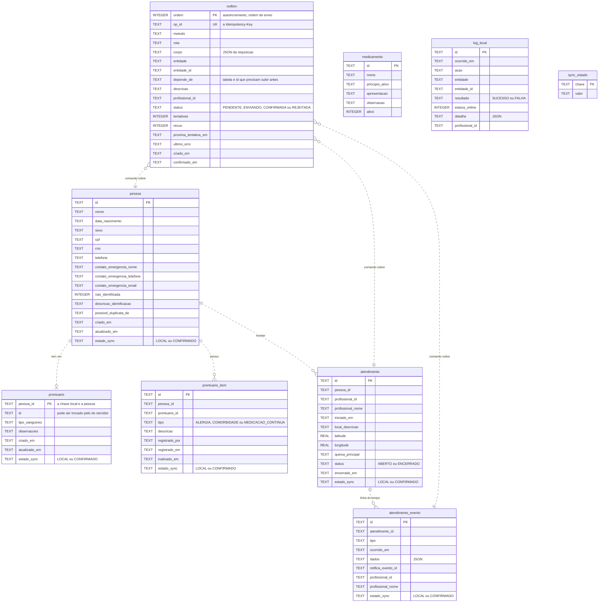
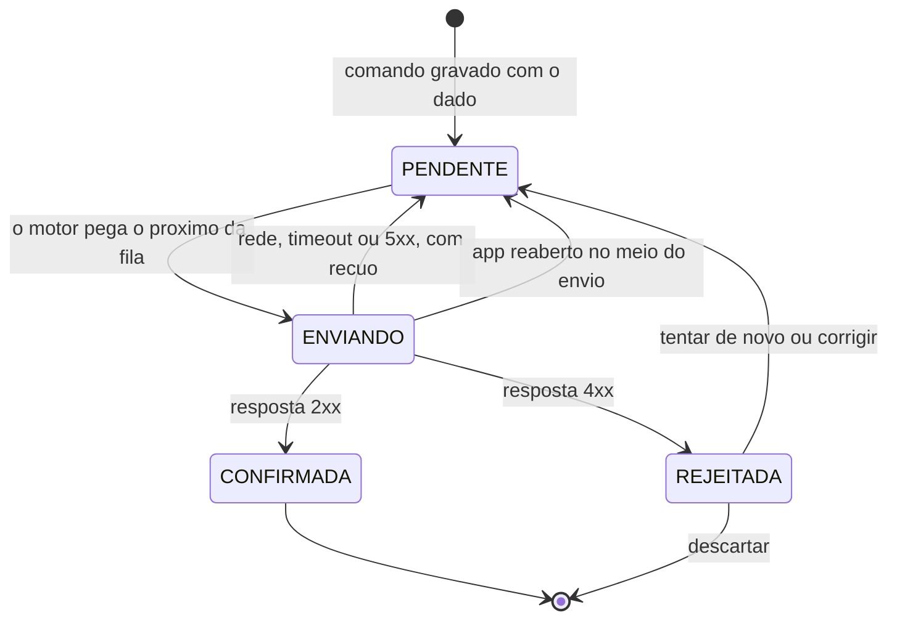

# Modelagem dos bancos de dados

**Entregável 2 do enunciado (parte dados) — modelagem dos bancos de dados.** As APIs estão em [`../api/README.md`](../api/README.md).

O enunciado pede **persistência dual**:

| Banco | Tecnologia | Papel | Definido em |
| --- | --- | --- | --- |
| **Central** | PostgreSQL 17 | Consolida prontuários, atendimentos, documentos e auditorias | `apps/*/migrations/*.sql` |
| **Local** | SQLite embarcado no app | Sustenta a operação offline: espelho dos cadastros, registros feitos no aparelho e a fila de envio | `apps/lucky-patcher/src/banco/migracoes/001_inicial.sql` |

Os diagramas abaixo foram escritos a partir dessas migrações — elas são a fonte. As tabelas e os privilégios do banco central foram conferidos no banco em execução (`information_schema`).

Todos os dados são **fictícios e sem validade clínica**.

---

## 1. Banco central (PostgreSQL)

### 1.1 Organização

**Uma instância, um banco (`medicalfield`), quatro schemas, um papel de banco por serviço.** Cada serviço é dono lógico de um schema e só enxerga o que lhe foi concedido.

| Schema | Serviço dono | Tabelas | Migração |
| --- | --- | --- | --- |
| `identidade` | MikeBaguncinha | `profissional`, `sessao` | `apps/mike-baguncinha/migrations/20261117000100_identidade_e_auditoria.sql` |
| `auditoria` | MikeBaguncinha (os três gravam o log de acesso) | `log_acesso`, `log_cliente` | idem |
| `clinico` | DonaCida | `medicamento`, `pessoa`, `prontuario`, `prontuario_item`, `atendimento`, `atendimento_evento`, `operacao_sync`, `auditoria_clinica` | `apps/dona-cida/migrations/20261117000200_clinico.sql` |
| `documentos` | Jaiminho | `documento`, `envio_email` | `apps/jaiminho/migrations/20261117000300_documentos.sql` |

São **14 tabelas**. Cada schema tem ainda uma `schema_migrations`, do `dbmate`.

Cargas de demonstração (dados fictícios, com ids fixos): `..._000150_profissionais_demo.sql` (3 profissionais) e `..._000250_dados_demo.sql` (12 medicamentos, 3 pessoas, 3 prontuários, 6 itens).

Os schemas e os `GRANT USAGE` são criados por `deploy/db/schemas.sql`; os papéis, por `deploy/base/postgres/10-papeis-e-schemas.sh` (cluster) ou `scripts/dev-db.sh` (desenvolvimento).

**Não há chave estrangeira entre schemas.** Um serviço referencia o dado de outro por id, sem restrição no banco — é o que mantém cada schema independente. Nos diagramas, linha contínua é chave estrangeira real; linha tracejada é referência lógica.

### 1.2 Schemas `identidade` e `auditoria`



| Tabela | Guarda | Destaques |
| --- | --- | --- |
| `identidade.profissional` | Quem pode entrar | `UNIQUE (tipo_registro, registro, uf)`; a senha só como *hash*. |
| `identidade.sessao` | Uma linha por *refresh token* emitido | Só o *hash* do token; a rotação revoga a antiga e cria a nova num único comando. |
| `auditoria.log_acesso` | **Uma linha por requisição HTTP, de todos os serviços** — os 7 campos do enunciado + `servico` + `request_id` | Índices por `data_hora` e por `profissional_id`. Somente inserção. |
| `auditoria.log_cliente` | Logs gerados pelo app (inclusive offline), recebidos por `POST /log` | A chave é o `id` do aparelho: reenviar não duplica. Somente inserção. |

### 1.3 Schema `clinico`



| Tabela | Guarda | Destaques |
| --- | --- | --- |
| `medicamento` | Cadastro de apoio | Somente leitura para os clientes. Inserido **pelo banco** (passo 9 do roteiro). Nunca apagar: `ativo = false`. |
| `pessoa` | Paciente | `cpf` **sem `UNIQUE`**: duplicata provável é sinalizada (`possivel_duplicata_de`), nunca rejeitada. `carimbos_campos` sustenta a estratégia "campo mais recente". |
| `prontuario` | Dados permanentes da pessoa | `pessoa_id` é `UNIQUE`: um prontuário por pessoa. |
| `prontuario_item` | Alergias, comorbidades, medicações contínuas | Acréscimo sempre vence; remover é uma **inativação** assinada. |
| `atendimento` | Uma ocorrência | Duas horas: `iniciado_em` (aparelho) e `recebido_em` (servidor) — a diferença mostra quanto tempo ficou offline. |
| `atendimento_evento` | **Linha do tempo imutável** do atendimento | Tipos: `SINAIS_VITAIS`, `GLASGOW`, `TRIAGEM`, `MEDICACAO`, `PROCEDIMENTO`, `OBSERVACAO`, `RETIFICACAO`, `ENCERRAMENTO`. Corrigir = novo evento `RETIFICACAO`. Somente inserção. |
| `operacao_sync` | Cada comando recebido — idempotência e rastreabilidade | Chave primária = `Idempotency-Key`. Somente inserção. |
| `auditoria_clinica` | Quem criou ou alterou dado de saúde, com antes/depois | Gravada na **mesma transação** do dado. Somente inserção. |

O conteúdo de `atendimento_evento.dados` por tipo está em [`../contratos.md`](../contratos.md) (seção 6) e é validado pelo esquema em `packages/contratos/src/cida.ts`.

### 1.4 Schema `documentos`



| Tabela | Guarda | Destaques |
| --- | --- | --- |
| `documento` | A ficha gerada, **com o PDF dentro** (`bytea`) | `UNIQUE (atendimento_id, hash_conteudo)`: mesmo conteúdo → mesmo documento. O PDF guardado é a prova do que foi enviado; `hash_pdf` permite conferir a integridade. Somente inserção. |
| `envio_email` | **A fila de envio** e o histórico | Consumida com `FOR UPDATE SKIP LOCKED`; índice `(status, proxima_tentativa_em)`. Registra quem pediu, para quem e com qual vínculo. |

### 1.5 Papéis de banco e privilégios

As migrações rodam como **administrador** (`postgres`), por uma imagem única (`deploy/migracoes/Dockerfile`) num `initContainer`. Os serviços se conectam com um papel restrito, que **não é dono** das tabelas — é isso que torna o "somente inserção" uma regra do banco, e não uma promessa do código.

Privilégios reais (`information_schema.role_table_grants`, conferidos no cluster local):

| Tabela | `mf_mike` | `mf_cida` | `mf_jaiminho` |
| --- | --- | --- | --- |
| `identidade.profissional` | SELECT, INSERT, UPDATE | — | — |
| `identidade.sessao` | SELECT, INSERT, UPDATE | — | — |
| `auditoria.log_acesso` | **SELECT, INSERT** | **INSERT** | **INSERT** |
| `auditoria.log_cliente` | **SELECT, INSERT** | — | — |
| `clinico.medicamento` | — | SELECT | — |
| `clinico.pessoa` | — | SELECT, INSERT, UPDATE | — |
| `clinico.prontuario` | — | SELECT, INSERT, UPDATE | — |
| `clinico.prontuario_item` | — | SELECT, INSERT, UPDATE | — |
| `clinico.atendimento` | — | SELECT, INSERT, UPDATE | — |
| `clinico.atendimento_evento` | — | **SELECT, INSERT** | — |
| `clinico.operacao_sync` | — | **SELECT, INSERT** | — |
| `clinico.auditoria_clinica` | — | **SELECT, INSERT** | — |
| `documentos.documento` | — | — | **SELECT, INSERT** |
| `documentos.envio_email` | — | — | SELECT, INSERT, UPDATE |

Em negrito, as tabelas **somente-inserção**. O que a tabela mostra:

- **Nenhum papel de serviço tem `DELETE`** em tabela alguma.
- **Sete tabelas não podem ser alteradas** por serviço nenhum: os dois logs de auditoria, a linha do tempo clínica, o registro de sincronização, a auditoria clínica e o documento.
- A DonaCida e o Jaiminho **gravam** o log de acesso mas **não o leem**; só o MikeBaguncinha lê (para a tela de auditoria).
- A DonaCida **só lê** medicamentos — quem insere é o administrador, pelo banco.
- Um serviço não tem `USAGE` no schema do outro: o Jaiminho não consegue ler `clinico`, nem a DonaCida `identidade`.

Uso de schema (`deploy/db/schemas.sql`): `identidade` → `mf_mike`; `auditoria` → os três; `clinico` → `mf_cida`; `documentos` → `mf_jaiminho`. O schema `public` é revogado de `PUBLIC`.

### 1.6 O cursor de sincronização (`seq`)

Problema: o app precisa perguntar "o que mudou desde a última vez?" e receber também o que foi inserido **à mão** no banco.

Solução, em `apps/dona-cida/migrations/20261117000200_clinico.sql`:

```sql
CREATE SEQUENCE clinico.seq_alteracao;

CREATE FUNCTION clinico.marcar_alteracao() RETURNS trigger
LANGUAGE plpgsql AS $$
BEGIN
  PERFORM pg_advisory_xact_lock(4815206);
  NEW.seq := nextval('clinico.seq_alteracao');
  NEW.atualizado_em := now();
  RETURN NEW;
END;
$$;

CREATE TRIGGER medicamento_marcar_alteracao BEFORE INSERT OR UPDATE ON clinico.medicamento
  FOR EACH ROW EXECUTE FUNCTION clinico.marcar_alteracao();
-- o mesmo gatilho em pessoa, prontuario e prontuario_item
```

Como funciona:

1. **Uma sequência global** para as quatro tabelas que descem ao app: `medicamento`, `pessoa`, `prontuario`, `prontuario_item`.
2. **Todo `INSERT` ou `UPDATE`** recebe o próximo número em `seq` — venha da API ou de um `INSERT` digitado no `psql`. Quem insere não precisa (nem consegue) informar o valor.
3. O app guarda o maior `seq` que já recebeu (o **cursor**) e pede `GET /api/v1/sync/alteracoes?desde=<cursor>`. O servidor devolve as linhas com `seq` maior, em ordem, e o novo cursor (`alteracoesDesde`, em `apps/dona-cida/src/infra/repositorio-clinico.ts`).
4. **A trava** (`pg_advisory_xact_lock`) serializa as escritas sincronizadas para que a ordem do `seq` seja a ordem de *commit*. Sem ela, uma transação lenta poderia confirmar com um `seq` menor que o cursor já entregue, e a linha nunca desceria. É uma simplificação consciente para o porte do trabalho; o comentário na migração indica a alternativa (`xid8` + `pg_snapshot_xmin`) se a vazão de escrita crescer.
5. As quatro tabelas são lidas em **uma única consulta** (`UNION ALL`), ou seja, num mesmo *snapshot*.

Inativar um medicamento (`UPDATE ... SET ativo = false`) também gera `seq` novo — a inativação desce. Um `DELETE` não geraria: por isso nada é apagado.

Demonstração (passo 9 do roteiro):

```sql
INSERT INTO clinico.medicamento (nome, principio_ativo, apresentacao)
VALUES ('Morfina 10 mg/mL', 'sulfato de morfina', 'ampola 1 mL')
RETURNING id, seq;   -- id e seq vêm preenchidos pelo banco
```

Atendimentos e eventos **não têm `seq`**: eles só sobem; não descem para outros aparelhos.

---

## 2. Banco local (SQLite no app)

Definido em `apps/lucky-patcher/src/banco/migracoes/001_inicial.sql`; a versão do esquema fica em `PRAGMA user_version` (`banco/banco.ts`, `migrar`).

| Plataforma | Implementação | Onde ficam os dados |
| --- | --- | --- |
| Navegador (PWA) | SQLite WASM oficial, VFS `opfs-sahpool`, dentro de um *Worker* (`banco/sqlite.worker.ts`) | OPFS — sistema de arquivos privado da origem. **Não cifrado.** |
| Android | `@capacitor-community/sqlite` com SQLCipher (`banco/executorCapacitor.ts`) | Arquivo nativo `databases/medicalfieldSQLite.db`, cifrado. Validado em emulador (E-008); não em aparelho físico. |
| Testes | O mesmo SQLite WASM, em memória (`banco/executorOo1.ts`) | — |

O banco local **não declara chaves estrangeiras**: a ordem de chegada dos dados (descida parcial, registro criado offline antes de o cadastro existir) não pode impedir uma gravação. As relações abaixo são lógicas.



### O que cada tabela guarda

| Tabela | Origem do dado | Guarda |
| --- | --- | --- |
| `medicamento` | **Desce** do servidor | Espelho do catálogo. O servidor sempre vence. |
| `pessoa` | Desce **e** é criada no aparelho | Espelho dos pacientes + os criados offline. |
| `prontuario` | Desce **e** é criado no aparelho | Identificado localmente pela **pessoa**: o servidor pode devolver outro id (quando a pessoa já tinha prontuário) e o id local é trocado sem quebrar referência. |
| `prontuario_item` | Desce **e** é criado no aparelho | Alergias, comorbidades, medicações contínuas. |
| `atendimento` | **Só** criado no aparelho | Os atendimentos feitos neste aparelho. Os de outros aparelhos não descem. |
| `atendimento_evento` | **Só** criado no aparelho | A linha do tempo de cada atendimento local. |
| `outbox` | Gerada pelo app | **A fila de sincronização**: um comando serializável por operação, gravado na mesma transação do dado. |
| `log_local` | Gerada pelo app | Auditoria local (login, registros, troca do seletor, sincronizações), até subir por `POST /log`. Sem dado de paciente. |
| `sync_estado` | Gerada pelo app | Chave-valor: `cursor` (último `seq` recebido), `dispositivo_id`, `ultima_sync`, `modo_simulado` (o seletor Online/Offline), `sessao`, `servidor`. |

### `estado_sync` e `outbox.status`

Toda linha que pode ser criada no aparelho tem `estado_sync`:

| Valor | Significado |
| --- | --- |
| `LOCAL` | Só existe neste aparelho; há comando pendente no outbox. |
| `CONFIRMADO` | O servidor tem a linha. |

O selo que o profissional vê combina esse campo com o estado do comando mais antigo ainda não confirmado (`dados/contexto.ts`, `estadoEnvio`): **local**, **enviando**, **confirmado** ou **rejeitado**.



### Correspondência com o banco central

| Local | Central | Diferença |
| --- | --- | --- |
| `medicamento` | `clinico.medicamento` | Sem `seq` nem datas: o cursor fica em `sync_estado`. |
| `pessoa` | `clinico.pessoa` | Sem `carimbos_campos` (a resolução é do servidor); com `estado_sync`. |
| `prontuario` | `clinico.prontuario` | Chave primária é `pessoa_id`. |
| `prontuario_item` | `clinico.prontuario_item` | Leva `pessoa_id` (o `prontuario_id` pode ainda não ser o definitivo). |
| `atendimento` | `clinico.atendimento` | Sem `prontuario_id` — o servidor resolve — e sem `recebido_em`. |
| `atendimento_evento` | `clinico.atendimento_evento` | `dados` é JSON em texto. |
| `outbox` | `clinico.operacao_sync` | `op_id` é a mesma chave dos dois lados. |
| `log_local` | `auditoria.log_cliente` | Mesmo `id`; a linha local é apagada depois de confirmada. |

O fluxo completo entre os dois bancos está em [`../arquitetura/sincronizacao.md`](../arquitetura/sincronizacao.md).
